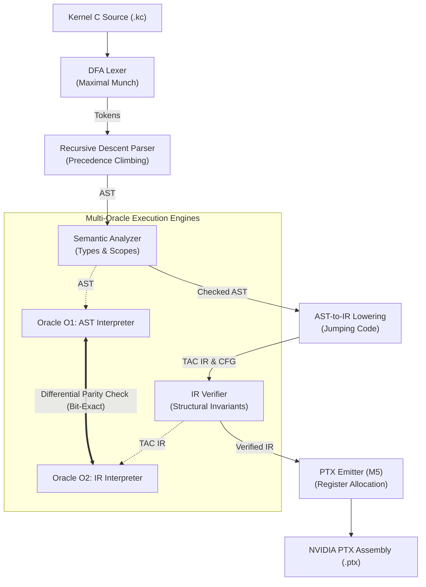

# 🚀 PTXLab (`kcc`)

**A modern, production-grade C++20 compiler for the Kernel C (KC) GPU programming language targeting NVIDIA PTX.**

PTXLab is an end-to-end domain-specific GPU compiler built from first principles in modern C++20. It compiles **Kernel C (KC)**—a C-dialect tailored for massively parallel GPU computation—into strongly typed Three-Address Code (TAC) Control Flow Graphs (CFG) and emits native NVIDIA PTX assembly for hardware execution.

---

## 🌟 Key Highlights

* **Pure First-Principles Design:** Handcrafted Deterministic Finite Automaton (DFA) Lexer, Precedence-Climbing Recursive Descent Parser, and Typed Three-Address Code (TAC) IR.
* **Rigorous Safety & Type System:** Scoped symbol resolution with zero implicit type coercions—all casts (`i32(...)`, `f32(...)`) must be explicit.
* **Control Flow Graph (CFG) & Verifier:** First-class basic blocks, explicit branch/conditional jump terminators, bidirectional CFG edge tracking, and an IR Verifier enforcing structural invariants.
* **Multi-Oracle Differential Testing:** Bit-exact verification between the AST Reference Interpreter (**Oracle O1**) and the TAC IR Interpreter (**Oracle O2**).
* **Safe Undefined Behavior (UB) Traps:** Catches integer division by zero, signed division overflow (`INT_MIN / -1`), out-of-bounds buffer indexing, and invalid bit-shift bounds before they cause GPU memory corruption.
* **Zero Compiler Warnings:** Maintained under `-Wall -Wextra -Wpedantic -Wconversion` (or `/W4` on MSVC) with 100% test pass rate across 119 unit tests.

---

## 🏗️ Compiler Architecture

PTXLab is structured as a decoupled, multi-pass compiler pipeline:



---

## 💻 What is Kernel C (KC)?

**Kernel C (KC)** is a GPU domain-specific language designed for expressing compute kernels simply and safely.

### Example: SAXPY Kernel (`saxpy.kc`)
```c
// saxpy: y[tid] = a * x[tid] + y[tid]
kernel saxpy(i32 n, f32 a, f32* x, f32* y) {
    i32 tid = tid_x();
    if (tid < n) {
        y[tid] = a * x[tid] + y[tid];
    }
}
```

### Language Features
* **Types:** Primitive scalars (`i32`, `f32`, `bool`) and 64-bit device pointers (`i32*`, `f32*`).
* **GPU Builtins:** Built-in hardware thread and block coordinates (`tid_x()`, `ctaid_x()`, `ntid_x()`).
* **Control Flow:** `if / else`, `while`, `for`, and `return`.
* **Short-Circuit Logic:** Boolean operations (`&&`, `||`, `!`) lowered into efficient jumping code without redundant predicate materialization.

---

## 🛠️ Building & Testing

### Prerequisites
* **C++ Compiler:** GCC 13+, Clang 16+, or MSVC 2022+ with full **C++20** support.
* **Build System:** [CMake](https://cmake.org/) (>= 3.25) and [Ninja](https://ninja-build.org/).
* **Target Hardware (Optional):** NVIDIA GPU with compute capability `sm_75` through `sm_120` (Blackwell).

### 1. Configure and Build
```bash
# Clone the repository
git clone https://github.com/ankhu1610/PTXLab.git
cd PTXLab

# Configure build with Ninja
cmake -B build -G Ninja -DCMAKE_BUILD_TYPE=Release

# Compile compiler binary (kcc) and unit tests
cmake --build build
```

### 2. Run Test Suite
```bash
ctest --test-dir build --output-on-failure
```
```text
100% tests passed out of 127
Total Test time (real) = 1.05 sec
```

---

## 🎮 Command-Line Interface (`kcc`)

The compiler executable `kcc` provides inspection flags for each compilation pass:

```text
Usage: kcc [options] <input.kc>

Options:
  -h, --help       Show help message
  -v, --version    Show compiler version
  -p, --pipeline   Trace full compiler flow (Tokens -> AST -> Sema -> IR -> Run -> PTX)
  --dump-tokens    [M1] Dump lexical token stream
  --dump-ast       [M2] Dump Abstract Syntax Tree (AST)
  --check          [M3] Perform syntax and semantic type check only
  --run-ast        [M3] Execute on CPU with AST Reference Interpreter (O1)
  --dump-ir        [M4] Dump Three-Address Code (TAC) IR
  --run-ir         [M4] Execute on CPU with TAC IR Reference Interpreter (O2)
  --emit-ptx       [M5] Generate PTX code to stdout or file
  -o <file>        Output file for generated PTX (default: stdout)
  --grid <N>       Number of thread blocks to launch (default 1)
  --block <M>      Number of threads per block (default 1)
```

### Example 1: Full Compiler Pipeline Trace
Watch the compiler step through every compilation phase and verify differential execution live:
```bash
./build/kcc --pipeline tests/programs/saxpy.kc
```

### Example 2: Dump Intermediate Representation (TAC IR)
```bash
./build/kcc --dump-ir tests/programs/saxpy.kc
```

### Example 3: Emit PTX Virtual ISA Assembly
```bash
./build/kcc --emit-ptx tests/programs/saxpy.kc
```
**Output:**
```ptx
// Generated by PTXLab Mini-Compiler (kcc)
.version 7.0
.target sm_75
.address_size 64

.visible .entry saxpy(
    .param .u32 _param_n,
    .param .f32 _param_a,
    .param .u64 _param_x,
    .param .u64 _param_y
)
{
    .reg .b32   %r<6>;
    .reg .f32   %f<12>;
    .reg .b64   %rd<13>;
    .reg .b64   %rd_offset;
    .reg .pred  %p<1>;

$L_entry:
    ld.param.u32    %r0, [_param_n];
    ld.param.f32    %f1, [_param_a];
    ld.param.u64    %rd2, [_param_x];
    cvta.to.global.u64 %rd2, %rd2;
    ld.param.u64    %rd3, [_param_y];
    cvta.to.global.u64 %rd3, %rd3;
    mov.u32         %r5, %tid.x;
    mov.u32         %r4, %r5;
    setp.lt.s32     %p0, %r4, %r0;
    @%p0 bra        $L_if_then_0;
    bra             $L_if_join_0;
$L_if_then_0:
    mul.wide.s32    %rd_offset, %r4, 4;
    add.s64         %rd6, %rd2, %rd_offset;
    ld.global.f32   %f7, [%rd6];
    mul.rn.f32      %f8, %f1, %f7;
    mul.wide.s32    %rd_offset, %r4, 4;
    add.s64         %rd9, %rd3, %rd_offset;
    ld.global.f32   %f10, [%rd9];
    add.rn.f32      %f11, %f8, %f10;
    mul.wide.s32    %rd_offset, %r4, 4;
    add.s64         %rd12, %rd3, %rd_offset;
    st.global.f32   [%rd12], %f11;
    bra             $L_if_join_0;
$L_if_join_0:
    ret;
}
```
**Output:**
```text
kernel saxpy(i32 %n, f32 %a, ptr_f32 %x, ptr_f32 %y) {
entry:
    %v0 = param 0
    %v1 = param 1
    %v2 = param 2
    %v3 = param 3
    %v5 = special tid_x
    %v4 = copy %v5
    %p0 = cmp.lt %v4, %v0
    condbr %p0, if_then_0, if_join_0

if_then_0:
    %v6 = elemaddr %v2, %v4
    %v7 = load %v6
    %v8 = fmul %v1, %v7
    %v9 = elemaddr %v3, %v4
    %v10 = load %v9
    %v11 = fadd %v8, %v10
    %v12 = elemaddr %v3, %v4
    store %v12, %v11
    br if_join_0

if_join_0:
    ret
}
```

---

## 📂 Project Structure

```text
PTXLab/
├── CMakeLists.txt                 # Root CMake build configuration
├── docs/                          # Specifications and status ledger
│   ├── grammar.md                 # Formal Kernel C Grammar (EBNF)
│   ├── lexer-dfa.md               # Lexer DFA state transition table
│   ├── STATUS.md                  # Milestone status ledger & verification evidence
│   └── design/                    # Architectural design documents (M0 to M5)
├── include/ptxlab/
│   ├── support/                   # Diagnostics, SourceManager, SourceLocation
│   ├── kc/                        # Lexer, Parser, AST, Scoped Symbol Table, Sema, O1
│   ├── ir/                        # TAC Instructions, BasicBlock, Function, CFG, Verifier, O2
│   └── ptx/                       # PTXEmitter for NVIDIA PTX Virtual ISA 7.0 (sm_75)
├── src/
│   ├── support/                   # SourceManager & DiagnosticEngine implementations
│   ├── kc/                        # Lexer, Parser, ASTPrinter, Sema, ASTInterpreter
│   ├── ir/                        # IRBuilder, IRPrinter, Lowering, IRVerifier, IRInterpreter
│   ├── ptx/                       # PTXEmitter assembly generator implementation
│   └── tools/
│       └── kcc.cpp                # kcc compiler CLI driver
├── tests/
│   ├── programs/                  # Test kernels in Kernel C (.kc)
│   ├── ptx_corpus/                # Reference PTX files
│   └── unit/                      # 127 GoogleTest unit test suites
└── tools/gate-lab/                # Formal grammar analyzer (FIRST/FOLLOW/LL(1))
```

---

## 🗺️ Project Milestones

| Milestone | Focus Area | Status | Evidence |
|:---:|---|:---:|---|
| **M0** | Native Windows C++20 Toolchain & Test Skeleton | **DONE** | CMake + Ninja + GCC 16.2 builds clean; CTest passing |
| **M1** | Source Manager, Diagnostics & DFA Lexer | **DONE** | Maximal munch DFA lexer; 39 unit tests |
| **M2** | Recursive-Descent Parser, AST & Gate-Lab Tool | **DONE** | LL(1) grammar analysis, panic recovery; 57 unit tests |
| **M3** | Semantic Analysis (Sema) & AST Interpreter (O1) | **DONE** | Scoped symbol table, strict types, UB traps; 101 unit tests |
| **M4** | Typed TAC IR, CFG, Verifier & IR Interpreter (O2) | **DONE** | BasicBlock CFG, jumping code, O1 == O2 parity; 119 unit tests |
| **M5** | PTX Emitter & Target Generation | **DONE** | PTX 7.0 / sm_75 generator, typed register banks, IEEE .rn, 127 unit tests |
| **M6** | GPU Runner (O4) via CUDA Driver API | **NEXT** | Hardware execution on RTX 5070 Ti (sm_120) |
| **M7** | PTX-subset Parser, Validator & Interpreter (O3) | Pending | Independent validation oracle |
| **M8** | Data-Flow Analysis & Optimizations (CP, DCE, CSE)| Pending | Optimization pipeline |
| **M9** | Multi-Oracle Differential Testing (`ptxdiff`) | Pending | Automated fuzzer and oracle comparison |
| **M10**| Fuzz Generator & Mutation Testing | Pending | Random program generator and bug minimizer |
| **M11**| Performance Evaluation & Final Presentation | Pending | Benchmarks against native CUDA `nvcc` |

---

## 📜 License

This project is developed under an open educational and research license for compiler construction and GPU systems programming.
