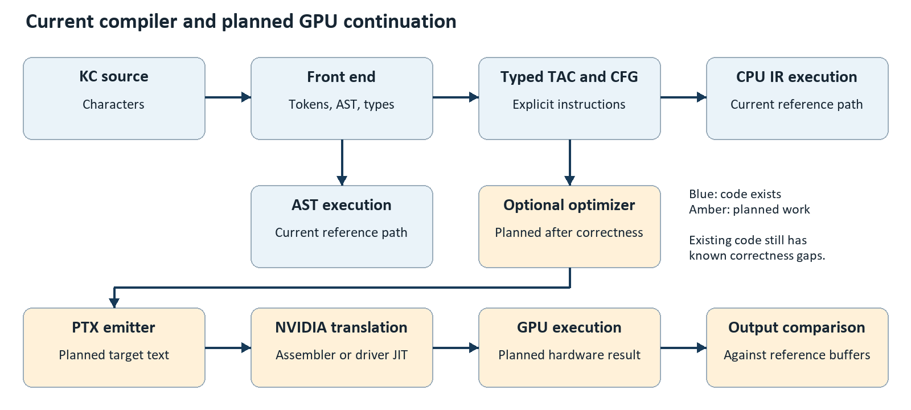
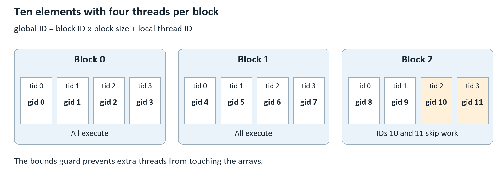
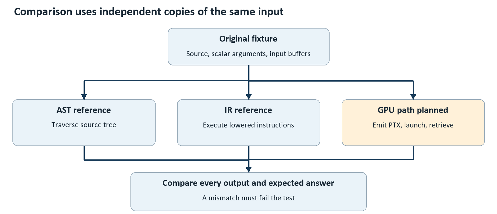

# PTXLab Architecture and Interview Guide

From GATE compiler concepts to a small NVIDIA GPU compiler

Prepared for the owner of PTXLab on 23 October 2026. Repository baseline: `fb150d8`. This is a study guide and an implementation proposal, not a record of newly completed compiler features.

## Contents

- [1 How to use this guide](#1-how-to-use-this-guide)
- [2 Project purpose and honest current status](#2-project-purpose-and-honest-current-status)
- [3 Current architecture](#3-current-architecture)
- [4 Front end](#4-front-end)
- [5 IR and execution](#5-ir-and-execution)
- [6 GPU architecture from first principles](#6-gpu-architecture-from-first-principles)
- [7 Planned PTX backend and GPU runner](#7-planned-ptx-backend-and-gpu-runner)
- [8 Planned optimizations using GATE concepts](#8-planned-optimizations-using-gate-concepts)
- [9 Correctness testing and the repair backlog](#9-correctness-testing-and-the-repair-backlog)
- [10 Implementation plan for four to seven days](#10-implementation-plan-for-four-to-seven-days)
- [11 Learning path from GATE CS to this project](#11-learning-path-from-gate-cs-to-this-project)
- [12 Interview preparation and practice](#12-interview-preparation-and-practice)
- [13 Glossary references and readiness check](#13-glossary-references-and-readiness-check)

## 1 How to use this guide

Your project already has a language front end, a typed three-address intermediate representation, a control-flow graph, and CPU execution engines for the AST and IR. The most useful next step is to connect that work to real PTX generation and checked GPU execution. With four days to one week remaining, complete that path before attempting several advanced optimizations.

This guide assumes you understand GATE CS topics such as finite automata, context-free grammars, parsing, symbol tables, intermediate code, basic blocks, graphs, and elementary computer architecture. It does not assume that you have written CUDA or studied GPU hardware. New GPU terms are introduced before they are used in the proposed backend design.

The aim is to make you capable of tracing one program through the project, explaining why each representation exists, identifying the boundary between your compiler and NVIDIA's tools, and defending your testing and scope decisions. Reading alone is insufficient: the exercises ask you to draw graphs, calculate values, inspect source, and explain failures aloud.

### 1.1 Four labels that keep your explanation accurate

- **IMPLEMENTED:** Relevant source code exists in this repository. This label does not claim that every input works.
- **KNOWN GAP:** Source inspection found a missing check, incorrect operation, or misleading claim. It needs a regression test and repair.
- **PLANNED:** A recommended addition for the remaining four to seven days. Do not describe it as completed until it is built and tested.
- **DEFERRED:** An educational or industrial topic deliberately excluded from this deadline.

Historical documentation reports 119 passing tests. This audit independently counted 119 test definitions but could not reproduce the result: Windows Application Control blocked the MinGW compiler, the cached build tool, and the existing project executables with exit code `0xc0e90002`. A fresh passing baseline is therefore still required. No compiler implementation was changed while preparing this guide.

The machine reported an NVIDIA GeForce RTX 5070 Ti Laptop GPU, driver 591.91, and compute capability 12.0 through `nvidia-smi`. That confirms a detected device; it does not establish that the CUDA development toolkit, PTX assembly, or this project's GPU runner works. `ptxas` and `nvcc` were not found in PATH during the audit.

### 1.2 The first three reading sessions

**Session one: understand what exists.** Read sections 2 through 5. Keep the source open. Trace one assignment from the lexer to the AST, then to IR instructions and the IR interpreter. Draw the control-flow graph yourself before looking at the explanation.

**Session two: understand where execution will happen.** Read sections 6 and 7. Calculate global thread indices for a launch with several blocks. Explain which parts execute on the host CPU and which execute on the GPU. Learn the difference between PTX and final machine code.

**Session three: understand how to trust and improve it.** Read sections 8 through 10. Work one liveness example by hand. Explain how two interpreters can agree and still be wrong. Choose the four-day core or the seven-day extension using the acceptance criteria.

Use sections 11 through 13 for revision, interviews, and terminology. If the interview is imminent, learn the architecture and status first; then practise the short pitch and the questions you cannot yet answer without looking.

### 1.3 A useful standard for understanding

For every component, answer five questions: What is its input? What is its output? What invariant does it establish? What can fail? Which test would reveal that failure? If you can answer these with one concrete program, you understand more than the component's name.

Do not memorize every method. Learn the important contracts: parser produces a structurally meaningful AST; sema resolves names and assigns/checks types; lowering translates meaning into explicit operations and control flow; verification checks selected invariants; an interpreter gives observable behavior; a backend encodes those operations for a target.

## 2 Project purpose and honest current status

### 2.1 What problem PTXLab addresses

PTXLab is an educational compiler written in C++20 for a small C-like language called Kernel C, abbreviated KC. A KC kernel describes work that can be performed by many logical threads. The compiler currently translates KC into a typed intermediate representation and can simulate execution on the CPU. The proposed backend will emit a restricted PTX program for NVIDIA's toolchain to translate into GPU machine code.

Its value is the visible connection between compiler theory and an executable target: expressions become instructions, structured statements become graph edges, array indexing becomes address arithmetic, and correctness is tested by comparing executions at different representations. It is not a replacement for CUDA C++, LLVM, or NVIDIA's production compiler.

The main executable is `kcc`. Supporting code is separated into libraries for diagnostics/source handling, the language front end, IR, and the grammar laboratory. The build system is CMake with GoogleTest-based tests. These separations let you discuss architecture without claiming a large industrial framework.

### 2.2 Current and planned capabilities

| Area | Audited state | Honest interview statement |
|---|---|---|
| Source handling and lexer | IMPLEMENTED | I have source locations, diagnostics, and a handwritten lexer. |
| Parser and AST | IMPLEMENTED | I parse a small structured kernel language into owned AST nodes. |
| Semantic analysis | IMPLEMENTED with gaps | I check names, scopes, and strict types; some edge cases need repair. |
| AST interpreter | IMPLEMENTED with gaps | I have a CPU reference execution path for the source AST. |
| Typed TAC and CFG | IMPLEMENTED with gaps | I lower to mutable virtual registers and explicit basic blocks. |
| IR verifier | IMPLEMENTED partially | It checks structure and selected instruction types, not a full proof of correctness. |
| IR interpreter | IMPLEMENTED with gaps | A second CPU execution path runs the lowered instructions. |
| Differential checking | LIMITED | A SAXPY unit test compares AST and IR output; the CLI comparison is incomplete. |
| PTX backend and GPU runner | PLANNED | These are the next parts of the end-to-end pipeline. |
| Optimizations | PLANNED | Local integer folding first; liveness-based DCE only if time permits. |
| Independent PTX interpreter | DEFERRED | It is useful future verification work, outside this deadline. |

The milestone names in older documents do not override these qualifications. M0 through M4 have source implementations, but the M4 completion claim needs the correctness work listed in section 9. M5 onward is not implemented in the audited source tree.

### 2.3 What the command line currently means

| Existing option | Purpose | Important qualification |
|---|---|---|
| `--dump-tokens` | Print the lexical token stream | Useful for lexical debugging. |
| `--dump-ast` | Print parsed structure | A printed AST does not prove type correctness. |
| `--check` | Parse and run semantic checking | Does not execute the program. |
| `--dump-ir` | Lower, verify, and print IR | Current verifier covers only some invariants. |
| `--run-ast` | Run the AST interpreter | Current driver lowers/verifies IR before reaching this option. |
| `--run-ir` | Run the IR interpreter | Integer-pointer fixture allocation currently has a bug. |
| `--pipeline` | Print stages and run both interpreters | The printed parity success is not backed by a buffer comparison. |
| `--grid`, `--block` | Set simulated launch dimensions | They do not launch the GPU. |

`--emit-ptx` is printed in help but is not handled by the option parser. It is not a working feature yet. Existing execution options choose the first kernel and invent demonstration arguments: integer scalars use the total thread count, floats use 1.0, booleans use true, and buffers are initialized to zero. This is convenient for a smoke test but not a general execution interface and not strong correctness evidence. See [the CLI implementation](../src/tools/kcc.cpp).

### 2.4 The representation ladder



The current path is `KC source -> tokens -> AST -> checked AST -> typed TAC and CFG -> CPU IR execution`. The AST can also be evaluated directly by its CPU interpreter. The planned continuation is `typed TAC and CFG -> optional optimization -> PTX text -> NVIDIA translation -> GPU execution`.

Each arrow changes a representation or performs a check. The GPU does not execute your C++ parser, and the current IR interpreter is not a GPU emulator. PTX is a target representation for your compiler, while final instruction scheduling and machine register assignment are downstream responsibilities.

The names O1 and O2 in existing project documentation mean **Oracle 1** and **Oracle 2**, namely AST and IR execution. They are not compiler optimization levels. In this guide, `AST reference`, `IR reference`, and `GPU result` are used wherever possible to avoid that ambiguity.

### 2.5 What would make the project strong within one week

The target is a small collection of race-free KC programs that translate to accepted PTX, execute on the detected NVIDIA GPU, and agree with independently checked CPU results. A single understandable optimization with before/after evidence is an optional extension. The most persuasive demonstration has accurate boundaries, actual output checks, and a bug story you can explain.

The project should make clear which language operations the PTX backend supports. When an operation is unsupported, compilation must fail with a useful diagnostic. Do not quietly generate a default instruction or omit work. A smaller supported language is acceptable; silent miscompilation is not.


## 3 Current architecture

### 3.1 What this compiler currently does

The implemented core translates a small kernel language, KC, into a typed intermediate representation and provides two CPU interpreters. A **kernel** here is a function intended to perform the same computation for many logical threads. Its name does not mean that the current implementation launches a GPU. The interpreters simulate those threads using ordinary C++ loops.

The source-grounded pipeline is:

```text
KC source text
    -> lexer -> tokens
    -> parser -> abstract syntax tree (AST)
    -> semantic analysis -> checked, typed AST
         |                         |
         |                         -> lowering -> typed TAC + CFG
         |                                            |
         -> AST interpreter                           -> IR verifier
                                                          |
                                                          -> IR interpreter
```

**TAC** means three-address code: a complex expression is decomposed into small operations, often with one destination and two inputs. **CFG** means control-flow graph: nodes are basic blocks, and directed edges describe possible execution transfers. Both concepts connect directly to GATE compiler design.

The repository calls its AST interpreter "O1" and IR interpreter "O2." These identify two reference execution paths; they are not compiler optimization levels `-O1` and `-O2`. The present pipeline does not establish optimized native or GPU code generation. The audit counted 119 authored tests across the project, but build/test execution during this review was blocked by Windows App Control with status `0xc0e90002`. Treat the explanations below as source inspection and teaching examples, not fresh passing-test evidence.

### 3.2 Module responsibilities and ownership

| Component | Responsibility | Useful source entry point |
|---|---|---|
| Driver | Parses options, reads input, selects stages, prepares demonstration arguments | [kcc.cpp](../src/tools/kcc.cpp), `main`, line 37 |
| Source and diagnostics | Owns source text, maps offsets to locations, records and formats errors | [source_manager.cpp](../src/support/source_manager.cpp), lines 6-42 |
| Lexer | Converts characters into classified tokens | [lexer.cpp](../src/kc/lexer.cpp), `nextToken`, line 191 |
| Parser and AST | Recognizes grammar and constructs a tree | [parser.cpp](../src/kc/parser.cpp), `parseProgram`, line 64; [ast.h](../include/ptxlab/kc/ast.h), line 71 |
| Semantic analysis | Resolves names, checks scopes/types, annotates expressions | [sema.cpp](../src/kc/sema.cpp), `analyze`, line 9 |
| AST interpreter | Executes checked source structure using scoped variable maps | [ast_interpreter.cpp](../src/kc/ast_interpreter.cpp), `launch1D`, line 68 |
| Lowering and builder | Converts typed AST operations into IR instructions and blocks | [lower.cpp](../src/ir/lower.cpp), line 5; [ir_builder.cpp](../src/ir/ir_builder.cpp), line 5 |
| IR model | Owns functions, blocks, instructions and typed operands | [module.h](../include/ptxlab/ir/module.h), line 11; [instruction.h](../include/ptxlab/ir/instruction.h), line 12 |
| IR verifier/interpreter | Checks selected IR invariants; executes instructions and branches | [ir_verifier.cpp](../src/ir/ir_verifier.cpp), line 6; [ir_interpreter.cpp](../src/ir/ir_interpreter.cpp), line 41 |

Ownership matters in a C++ interview. `Program` owns kernels, kernels own their bodies, and statements/expressions own their children through `std::unique_ptr`. Destroying the root therefore releases the tree. An `ASTVisitor` provides separate operations over the same node hierarchy: printing, semantic analysis and execution do not need to be embedded inside every node. Lowering uses explicit node-type checks instead of inheriting that visitor interface.

Similarly, an IR `Module` owns `Function` objects; functions own `BasicBlock` objects; blocks own instructions. CFG predecessor/successor pointers and block parent pointers are non-owning relationships. They reference objects whose lifetime is controlled by the owning containers. Tokens carry `string_view` slices of source text, so the source manager must outlive their use. This is a practical example of avoiding unnecessary string copies while preserving lifetime discipline.

### 3.3 Driver flow and architectural boundaries

The parser requests tokens from the lexer as needed; the normal compilation path does not first require a complete token vector. `--dump-tokens` is a separate inspection path. `--dump-ast` stops before semantic analysis, so its output is a parsed tree rather than evidence that names and types are valid. `--check` performs parsing and semantic checking, then returns. The regular execution path lowers and verifies before choosing `--dump-ir`, `--run-ast` or `--run-ir` ([kcc.cpp](../src/tools/kcc.cpp), lines 274-399).

That last detail is worth explaining accurately: although AST interpretation logically needs only a checked AST, the current CLI reaches IR lowering/verification before its `--run-ast` branch. A lowering defect can consequently prevent that CLI command from exercising the AST interpreter. Direct unit-test use of the interpreter does not have this driver dependency.

The `--pipeline` option constructs a verbose demonstration of the stages and runs both interpreters. It currently prints a bit-for-bit parity message after both return without comparing their output buffers ([kcc.cpp](../src/tools/kcc.cpp), lines 252-262). A separate SAXPY unit test does perform element comparisons. Distinguish the existence of the two execution paths, the test's comparison, and the CLI's unsupported success message.

### 3.4 A suitable interview explanation

"I implemented a small typed language for elementwise kernels. A handwritten lexer and recursive-descent parser build an AST, and a scoped semantic pass checks it. I lower that AST into non-SSA three-address code with explicit basic blocks. An AST interpreter provides a source-level reference, and an IR interpreter exercises the lowered representation. This makes frontend and lowering behavior inspectable before adding a GPU backend. The current verifier and test coverage have specific gaps that I have identified."

Use that explanation only for code you have studied and can defend. The strongest follow-up demonstration is tracing one program through every representation.

## 4 Front end

### 4.1 The worked KC program

This example uses only implemented syntax:

```c
kernel scale(i32 n, f32 a, f32* x, f32* y) {
    i32 i = ctaid_x() * ntid_x() + tid_x();
    if (i < n) {
        y[i] = a * x[i] + 1.0f;
    }
}
```

`ctaid_x()` is the block index, `ntid_x()` is the number of threads per block, and `tid_x()` is the thread index within its block. The global element index is therefore:

```text
i = block_index * threads_per_block + thread_index
```

For two blocks of four threads, the indices are `0..7`, not `0..3` twice. With `n = 5`, threads 5, 6 and 7 skip the memory operations. If `a = 2` and `x = [1,2,3,4,5]`, the intended result is `y = [3,5,7,9,11]`. These are manually derived expected values; this chapter does not claim that this example was executed during the audit. Supplying those exact arrays requires a test harness or improved argument interface because the existing CLI invents demonstration inputs.

### 4.2 Lexical analysis: characters become tokens

The lexer maintains a cursor into the source, uses `peek` for lookahead, and advances as it recognizes a token. It skips whitespace, `//` comments and `/* ... */` comments. It scans an identifier fully before deciding whether its spelling is a keyword. Numeric scanning handles decimal integers, hexadecimal integers, and floating-point forms including exponents and an optional `f` suffix.

For the index declaration, the conceptual token sequence is:

```text
KwI32 Identifier(i) Equal
Identifier(ctaid_x) LParen RParen Star
Identifier(ntid_x) LParen RParen Plus
Identifier(tid_x) LParen RParen Semicolon
```

The lexer does not know that `i` will be a local variable or that `tid_x` is a builtin. Those are later semantic decisions. A token stores its kind, source spelling, location and relevant numeric value. For `<=`, the lexer chooses one `LessEqual` token instead of separate `<` and `=` tokens. This is **maximal munch**, the familiar GATE rule of taking the longest valid token beginning at the current position.

The implementation is handwritten recognizer logic, not an automatically generated DFA table. Your automata knowledge explains why states such as "reading exponent digits" are useful, even though the code represents them with branches and loops. Read [lexer.cpp](../src/kc/lexer.cpp), lines 33, 70, 89, 138 and 191, for comments, identifiers, numbers, float tails and token dispatch respectively.

The scanner advances monotonically through the text, so the character-scanning work is linear in source length. A precise answer should mention location mapping: `SourceManager::getLocation` performs binary search over line-start offsets ([source_manager.cpp](../src/support/source_manager.cpp), line 27). With `N` characters, `T` location-producing token operations and `L` lines, a useful model is `O(N + T log L)`, not an unconditional claim that every part of lexing is constant time per character. The source manager computes line starts once in `O(N)`.

### 4.3 Parsing: tokens become structure

Parsing checks whether tokens obey the language's grammar. The parser is handwritten recursive descent: functions such as `parseKernel`, `parseIf` and `parseFor` correspond to grammar constructs. Expression precedence is encoded by a hierarchy of functions. `parseAdditive` obtains operands from `parseMultiplicative`, so multiplication groups more tightly than addition ([parser.cpp](../src/kc/parser.cpp), lines 340-359).

For `a + b * c`, the resulting structure is `+(a, *(b,c))`. For `a - b - c`, the additive loop repeatedly updates its left operand, producing `-(-(a,b),c)`. Thus precedence and associativity are separate properties: which operator groups first, and how repeated operators of one level group. Unary parsing recurses into itself, allowing expressions such as `-(-x)`.

This links to eliminating left recursion in GATE. A top-down parser cannot directly call itself first for `E -> E + T | T`; the implementation uses the equivalent shape `E -> T { + T }`. It is best described as recursive descent with explicit precedence levels, rather than claiming a generated LL(1) table drives the KC parser. The separate grammar-learning utility does not replace this parser.

The following AST is **schematic**. Names and indentation explain the structure; this is not a captured `--dump-ast` transcript:

```text
Program
  Kernel scale(n:i32, a:f32, x:f32*, y:f32*)
    Compound
      Decl i:i32
        Add
          Multiply
            Call ctaid_x()
            Call ntid_x()
          Call tid_x()
      If
        Less(Identifier i, Identifier n)
        Compound
          Assign
            Index(Identifier y, Identifier i)
            Add
              Multiply(Identifier a, Index(Identifier x, Identifier i))
              FloatLiteral 1.0
```

An AST omits punctuation that no longer carries information. The braces become a compound-statement node; multiplication order is represented by tree edges; parentheses need not survive as separate nodes. This makes an AST more compact and useful for later stages than a full parse tree.

For well-formed input, the parser consumes tokens without backtracking and builds a tree of proportional size. Normal parsing work is approximately linear in token count, with recursion depth determined by syntactic nesting. This is not a guarantee against stack exhaustion for arbitrarily deeply nested input. Error recovery is also a separate quality concern: `consume` reports a mismatch without necessarily advancing, and synchronization uses selected statement/declaration boundaries ([parser.cpp](../src/kc/parser.cpp), lines 28-62). Existing recovery examples do not establish robustness for every malformed input.

### 4.4 Semantic analysis: structure acquires meaning

The semantic pass answers questions grammar alone cannot answer: Is `i` declared? Is `x` indexable? Does the index have integer type? Can the expression be assigned to `y[i]`? Does the `if` condition produce a boolean?

`Sema` walks the AST and sets expression types. For the worked program, its derivation is:

| Expression | Reason | Result type |
|---|---|---|
| `ctaid_x()`, `ntid_x()`, `tid_x()` | Recognized zero-argument builtins | `i32` |
| `ctaid_x() * ntid_x() + tid_x()` | Matching integer operands | `i32` |
| `i < n` | Comparison of two integers | `bool` |
| `x[i]` | `f32*` base and `i32` index | `f32` |
| `a * x[i] + 1.0f` | Matching floating operands | `f32` |
| `y[i] = ...` | Floating element and floating value agree | Valid store |

The rules are intentionally strict. `i32 k = 1.5f;` is rejected; an explicit supported conversion is required. `if (1)` is rejected because conditions must be `bool`. A local `f32* p = x;` is rejected because pointer-valued locals are outside the supported subset, although pointer parameters and indexed access are supported. There are no general user-defined function calls; recognized calls are selected builtins and conversions ([sema.cpp](../src/kc/sema.cpp), lines 68, 119, 245, 340 and 369).

### 4.5 Symbol tables, scopes and shadowing

A **symbol table** maps a name to information such as its type and declaration location. Here each `Scope` owns an `unordered_map` and references its parent. Lookup starts in the current scope and walks outward; lookup for redeclaration checks only the current scope ([symbol_table.h](../include/ptxlab/kc/symbol_table.h), lines 20-48). Entering a compound statement creates a scope; leaving it restores the parent.

```c
i32 v = 10;
{
    i32 v = 20;
    // v resolves to the inner declaration here.
}
// v resolves to the outer declaration here.
```

This is lexical scoping: source nesting determines visibility. It is distinct from the value a variable happens to hold during execution. With ordinary hashing assumptions, lookup costs expected constant time per visited scope, or approximately `O(D)` for scope depth `D`; pathological hashing and string-processing costs prevent a universal constant-time claim.

One current edge case exposes the difference between scope and execution: `if (false) i32 v = 1;` is parsed as a declaration body, and semantic analysis adds `v` to the enclosing scope without creating a conditional-body scope. A later read can pass checking even though execution never created `v` ([parser.cpp](../src/kc/parser.cpp), line 206; [sema.cpp](../src/kc/sema.cpp), lines 87 and 119). Requiring braces around declaration bodies is a small language restriction that avoids this case; otherwise scope behavior must be implemented consistently across stages.

### 4.6 Frontend checkpoints

1. **Why does the lexer accept an undeclared identifier?** Its job is recognizing spelling categories; semantic analysis resolves declarations.
2. **Why is `1 + 2 * 3` grouped correctly?** The additive parser gets each operand from the tighter multiplicative parser.
3. **Why can a syntax-correct program still fail?** Name resolution, type rules and later runtime conditions impose additional constraints.
4. **Where does shadowing get resolved?** Nearest-enclosing-scope lookup, independently in semantic analysis and execution/lowering environments.

## 5 IR and execution

### 5.1 Why introduce an intermediate representation?

An AST is convenient for understanding source constructs. An IR makes execution order, temporary results, memory operations and branches explicit. Instead of teaching every future analysis how to traverse nested `if`, `while` and expression nodes, it can work over instructions and graph edges. This is the practical connection to GATE basic blocks, flow graphs and data-flow analysis.

The IR distinguishes `i32`, `f32`, predicate values, typed integer/float pointers and `void`. A **predicate** is a boolean value used for decisions. An operand is a register reference or literal constant. Instructions carry an opcode, optional destination, operands, source location and, where relevant, branch labels ([instruction.h](../include/ptxlab/ir/instruction.h), lines 12-241).

A **virtual register** is an IR identifier for a value-storage location, not an allocated hardware register. This project has no implemented physical register allocator. In the interpreter, registers are entries in C++ maps. A **basic block** is an instruction sequence ending in a transfer such as `Br`, `CondBr` or `Ret`; execution enters at the beginning and follows the sequence until that terminator.

### 5.2 Lowering the worked example

Lowering creates a function for each kernel, parameter instructions, local-variable register mappings and explicit control-flow blocks. `IRBuilder` centralizes instruction construction and tracks the current insertion block ([lower.cpp](../src/ir/lower.cpp), lines 55-122; [ir_builder.h](../include/ptxlab/ir/ir_builder.h), lines 13-35).

This is **schematic TAC**, not exact current printer output or a verified runtime artifact. Human-readable register names replace generated IDs; parameter and constant creation details are compressed:

```text
entry:
    %n = param 0 : i32
    %a = param 1 : f32
    %x = param 2 : ptr_f32
    %y = param 3 : ptr_f32
    %block = special ctaid_x
    %width = special ntid_x
    %thread = special tid_x
    %base = mul %block, %width
    %index = add %base, %thread
    %i = copy %index
    %inside = cmp.lt %i, %n
    condbr %inside, then, join

then:
    %xp = elemaddr %x, %i
    %xvalue = load %xp : f32
    %scaled = fmul %a, %xvalue
    %result = fadd %scaled, 1.0f
    %yp = elemaddr %y, %i
    store %yp, %result
    br join

join:
    ret
```

The CFG has edges `entry -> then`, `entry -> join`, and `then -> join`. A comparison produces the predicate; `CondBr` consumes it. Array reading becomes address calculation followed by `Load`; assignment becomes address calculation followed by `Store`. The interpreter's address representation is a buffer name plus an element offset, not a raw GPU address. A future backend must translate that abstraction into the target's actual addressing rules.

### 5.3 Why this IR is non-SSA

**Static single assignment**, or SSA, requires each register name to have one defining assignment. This IR allows reassignment. A local variable receives a register, and later source assignments emit copies into the same register ([lower.cpp](../src/ir/lower.cpp), lines 40-43 and 101-108).

```text
%sum = copy 0
...
%next = add %sum, %item
%sum = copy %next
```

The two definitions of `%sum` make this non-SSA even though expression temporaries often have fresh names. In SSA, successive values would use distinct names, and control-flow merges commonly need phi nodes: a phi chooses an incoming value according to the predecessor edge taken. There are no phi instructions here. Starting with mutable registers simplifies lowering and interpretation; it means future analyses must reason about multiple definitions instead of assuming SSA properties.

### 5.4 Conditions, short-circuiting and loops

For `a && b`, evaluating `b` is required only when `a` is true. For `a || b`, evaluating `b` is required only when `a` is false. This affects correctness even without function side effects: `false && (10 / 0 > 1)` must skip the division.

The AST interpreter implements these rules by returning before evaluating the right operand. The IR lowerer represents them with branches: an `&&` condition sends a true left result to an `and_rhs` block and a false result directly to the false destination. `||` reverses which result needs the right operand. Logical negation in condition context swaps the true/false destinations ([lower.cpp](../src/ir/lower.cpp), lines 219-265).

When a logical expression is used as a value, such as `bool ok = a && b;`, lowering creates true and false blocks. Each writes a different boolean into the same result register and branches to a join. That is another concrete demonstration of non-SSA representation ([lower.cpp](../src/ir/lower.cpp), lines 293-320).

The intended loop graphs are straightforward:

```text
while: entry -> header -> body -> header
                        \-> exit

for:   init -> header -> body -> step -> header
                       \-> exit
```

The header checks the condition. The body performs work. The `for` step changes loop variables. The back edge repeats the check. A `return` emits `Ret`; lowering should avoid adding a branch after an already terminated path.

There is a known nested-control-flow defect. After lowering a nested construct, the builder may be positioned at the nested construct's final join or exit block. The code checks the original `thenBB`, `elseBB` or `bodyBB` for a terminator instead of checking the current insertion block ([lower.cpp](../src/ir/lower.cpp), lines 138, 146, 167 and 198). That original block may already branch into the nested construct, causing the needed edge from the final block to be omitted. Therefore the diagrams describe the intended scheme; they do not justify claiming every nested combination works. A focused fix uses the actual current insertion point and tests nested conditionals, loops and early returns together.

### 5.5 Verification: useful checks with defined limits

The verifier checks that functions have blocks, the entry has no predecessors, blocks end in terminators, branch labels resolve, and selected instruction types are compatible. It also checks that successor links have matching predecessor links ([ir_verifier.cpp](../src/ir/ir_verifier.cpp), lines 14-199). These are **invariants**: properties the IR must maintain so later consumers can operate sensibly.

A verifier is not a proof that translation preserves source semantics. This implementation does not establish all opcode arities, conversion constraints, memory element-type relationships, or that a register is defined on every path before use. A graph can be structurally legal yet compute the wrong result. The builder, verifier, interpreter and tests provide different layers of evidence; none substitutes for the others.

Complexity also deserves care. `Function::getBlock` linearly scans blocks ([function.h](../include/ptxlab/ir/function.h), line 46). CFG reconstruction performs these lookups for branch targets. Consequently, an implementation-level estimate can include `O(E * B)` target resolution for `B` blocks and `E` edges, even though graph traversal with indexed targets would be `O(B + E)`. For small kernels this is acceptable; a label lookup map is an uncomplicated future improvement.

### 5.6 How the two interpreters execute

The AST interpreter stores variables in a stack of name-to-value maps. Expression visitors return values; statement visitors update state, choose branches or repeat loops. The IR interpreter instead starts at the entry block, executes instruction opcodes, and uses the terminator to choose the next block. It stores ordinary registers and predicates separately ([ir_interpreter.cpp](../src/ir/ir_interpreter.cpp), lines 9-39 and 41-69).

Both launch helpers run nested CPU loops over blocks and threads. Each logical thread gets fresh local state, while buffers persist across the launch. This supports studying per-thread arithmetic and indexing. It does not model warps, simultaneous execution, race freedom, synchronization, or GPU performance. Runtime cost depends on dynamic work: an instruction in a loop can execute many times. AST steps count statement/loop activity, while IR steps count instructions, so their execution-limit numbers are not directly comparable.

The buffer manager checks indices. Integer arithmetic uses unsigned intermediates for wraparound addition, subtraction and multiplication; division by zero, invalid shifts and other selected conditions raise `UBTrap`. One shared conversion bug remains: the upper float-to-integer check uses `2147483647.0f`, which rounds to `2147483648.0f`, allowing the invalid upper boundary through ([ast_interpreter.cpp](../src/kc/ast_interpreter.cpp), line 350; [ir_interpreter.cpp](../src/ir/ir_interpreter.cpp), line 291).

Two additional semantic gaps are visible in the IR path. Boolean equality falls through to comparing integer fields instead of boolean fields ([ir_interpreter.cpp](../src/ir/ir_interpreter.cpp), lines 240-253). Also, sema accepts `i32(bool)`, but lowering always selects the float-to-integer conversion for `i32(...)` ([lower.cpp](../src/ir/lower.cpp), lines 386-388). These are examples of why implementing a language feature requires agreement between checking, lowering and execution.

### 5.7 What differential testing establishes

**Differential testing** gives the same program and inputs to two implementations, then compares outputs. The SAXPY test constructs separate buffers, executes the AST and IR paths, and compares results with `EXPECT_FLOAT_EQ` ([test_ir_interpreter.cpp](../tests/unit/test_ir_interpreter.cpp), lines 47-96). That is an approximate floating comparison, not a demonstrated bitwise comparison.

Disagreement helps reveal lowering or interpreter bugs. Agreement still cannot prove correctness because both implementations may share a mistaken rule, as with the conversion boundary. Combine differential checks with independently calculated expected outputs, targeted boundary tests and verifier checks. For the worked scale kernel, `[3,5,7,9,11]` is an independent expected result; "both completed" is not.

### 5.8 IR checkpoints

1. **What makes this non-SSA?** Source assignments can redefine the same virtual register.
2. **Why use blocks for `&&`?** The right operand may need to remain unevaluated.
3. **What is the difference between an IR register and a GPU register?** One is a compiler-level identifier; the other is a target execution resource requiring allocation or further compilation.
4. **Why does a valid CFG not guarantee correct output?** Structural checks do not prove expression semantics or source-to-IR equivalence.
5. **What should be fixed before extending the language?** Known lowering/execution mismatches, real output comparison, and focused regressions for nested control flow and boundaries.


## 6 GPU architecture from first principles

**Learning objective:** connect familiar GATE computer architecture and operating-system ideas to the execution model that a PTX backend must respect. This chapter explains NVIDIA concepts; it does not claim that PTXLab already implements the backend or runs on a GPU.

### 6.1 Start with the problem, not the hardware vocabulary

Imagine calculating `out[i] = x[i] + 7` for one million array elements. Each output depends only on the corresponding input. Changing the order of independent element calculations does not change the answer. This independence is the opportunity: instead of giving one worker the entire array, assign many workers different indices.

Contrast this with following a linked list. The address of the next node depends on the current node's contents. Adding workers does not automatically eliminate that dependency. When discussing this project, start by identifying independent work; "GPU" is not a universal shortcut to faster execution.

A CPU emphasizes fast progress through a small number of instruction streams. A GPU emphasizes aggregate throughput from many threads. **Latency** is the time for one task; **throughput** is the amount of completed work per unit time. GPU architecture trades resources differently to favor throughput. This connects directly to pipelining and parallelism from computer organization. [NVIDIA's introduction to GPU design](https://docs.nvidia.com/cuda/cuda-programming-guide/01-introduction/introduction.html)

For our example, the objective is not to make a single addition dramatically faster. It is to keep many additions and memory operations progressing. Launching work and transferring inputs also take time, so a tiny array can be a poor performance demonstration even when compilation is correct. During the first week, use small arrays to expose mistakes and describe them as correctness tests.

### 6.2 Host, device, and the two meanings of kernel

The **host** is the CPU side of the application; the **device** is the GPU side. A GPU **kernel** is a function launched for execution by many device threads. It is unrelated to the operating-system kernel that manages processes and privileged resources. The CPU program prepares inputs and launches GPU work. [CUDA programming model](https://docs.nvidia.com/cuda/cuda-programming-guide/01-introduction/programming-model.html)

PTXLab will have two distinct responsibilities. `kcc` translates KC source into another representation. A runner arranges execution: obtain a device, allocate buffers, provide parameters, launch the function, and retrieve results. Compiling source does not itself allocate the output array or decide its contents.

For an interview, describe the division using one concrete sentence: "My compiler produces the kernel program; my host runner supplies the data and launch configuration." The current AST and IR interpreters already simulate part of that runner behavior on the CPU. They are useful references, but their implementation mechanism differs from hardware execution.

### 6.3 Logical work and physical hardware

Keep these terms separate:

| Term | Meaning | PTXLab connection |
|---|---|---|
| Thread | One logical execution of the kernel with its own scalar state | One interpreter invocation for a particular thread ID |
| Block | A group of threads in one launch | `ntid_x()` gives its x-dimension size |
| Grid | All blocks in the launch | The runner chooses the block count |
| Warp | A hardware execution grouping of 32 threads within a block | Helps explain memory access and divergent branches |
| Streaming multiprocessor, or SM | A physical GPU processing unit that schedules and executes warps | The compiler does not select a particular SM for each thread |

An SM can host multiple blocks when resources permit. A block's threads execute on one SM in the ordinary model used here. The grid can contain more work than fits simultaneously, so blocks may execute in waves. [CUDA's hardware and thread hierarchy](https://docs.nvidia.com/cuda/cuda-programming-guide/01-introduction/programming-model.html)

A CUDA thread is not a promise of a dedicated physical processor. Similarly, a block is not a permanently named hardware component. In a database analogy, a work item and the worker processing it are different things. The exact scheduling order should not determine the result of our demonstration kernels.

Do not memorize the laptop's SM count before understanding this distinction. The project's first backend needs thread coordinates and correct instructions, not a hard-coded model of all hardware resources. Hardware-specific tuning can follow a working program.

### 6.4 Work through global indexing completely

For a one-dimensional launch, use this KC expression:

```c
// Illustrative KC example for the planned GPU demonstration.
kernel add_seven(i32 n, i32* x, i32* out) {
    i32 gid = ctaid_x() * ntid_x() + tid_x();
    if (gid < n) {
        out[gid] = x[gid] + 7;
    }
}
```

In this project, `tid_x()` is the thread's position within its block, `ctaid_x()` identifies the block, and `ntid_x()` is the number of threads per block. The multiplication skips all positions belonging to earlier blocks; the addition picks the position inside the current block.

Take `n = 10` and block size `4`. The runner needs `ceil(10 / 4) = 3` blocks. The resulting twelve logical threads behave as follows:

| Block ID | Local thread IDs | Global IDs | Valid array work |
|---|---|---|---|
| 0 | 0, 1, 2, 3 | 0, 1, 2, 3 | Four elements |
| 1 | 0, 1, 2, 3 | 4, 5, 6, 7 | Four elements |
| 2 | 0, 1, 2, 3 | 8, 9, 10, 11 | IDs 8 and 9 only |

The condition prevents IDs 10 and 11 from reading or writing outside the arrays. If the source uses only `tid_x()`, each block repeats indices 0 through 3. A one-block test would hide that mistake. The checked-in SAXPY demo currently has that limitation; its differential unit-test variant already uses the global-ID formula.

Four threads per block makes the arithmetic easy to inspect. It is not a performance recommendation: a partial warp leaves lanes unused. Once correctness is established, a practical experiment can compare block sizes such as 128 and 256 while holding the problem constant. For the initial runner, also bound launch sizes so the chosen signed 32-bit index arithmetic cannot overflow.



### 6.5 Memory: scope and location are different questions

When someone says "local," ask whether they mean *private to a thread* or *physically near the processor*.

| Memory concept | Who uses the contents? | Physical interpretation |
|---|---|---|
| Registers | One thread's scalar values | On-SM register storage; capacity is finite |
| Shared memory | Threads cooperating within a block | On-chip storage associated with the SM |
| Global memory | Device code accessing allocated buffers | Device memory, accessed through the memory hierarchy |
| Local memory | Private storage for an individual thread | Device-memory-backed storage, potentially cached; "local" does not mean on-chip |

Register spilling can place private values into local memory. Consequently, a private variable is not automatically a cheap physical register. [CUDA memory spaces](https://docs.nvidia.com/cuda/cuda-programming-guide/02-basics/writing-cuda-kernels.html)

For PTXLab, keep the first implementation small: scalar temporaries become virtual registers, and pointer parameters refer to global buffers. Shared arrays, barriers, and inter-thread communication can remain unsupported. This is a conscious language boundary rather than an accidental omission.

Consider `i32 value = x[gid];`. `x` is an address, `gid` is an index, the load retrieves an integer from memory, and `value` is a scalar result. The TAC already separates address calculation from `load`, which makes these distinctions visible. In the CPU interpreter, the buffer manager represents memory using C++ containers. A GPU backend must translate that representation into real device addressing.

### 6.6 Coalescing: look across threads at one instruction

**Coalescing** combines memory requests from threads in a warp into memory transactions. Nearby addresses often require fewer transactions than widely scattered addresses. Consecutive threads accessing consecutive elements is a useful default, though alignment and the actual set of addresses also matter. [NVIDIA's global-memory explanation](https://developer.nvidia.com/blog/unlock-gpu-performance-global-memory-access-in-cuda/)

For `x[gid]` with four-byte integers, adjacent global IDs request addresses four bytes apart. For `x[gid * 64]`, adjacent IDs are much farther apart. Both expressions may be logically valid, but their memory behavior differs. The question is not merely how many loads each individual thread executes; it is how the addresses of the threads participating in a load fit together.

This connects to GATE cache locality, with an extra dimension: inspect simultaneous accesses from multiple threads. The simplest teaching diagram is a row of thread IDs above a row of requested array indices. The initial PTXLab demo should use contiguous element access so that performance discussions do not become entangled with a deliberately poor memory pattern.

Coalescing does not repair a race. Two threads modifying the same value can be close in memory and still be incorrect.

### 6.7 Divergence: different paths inside one warp

SIMT lets the programmer describe a scalar thread while hardware groups threads for execution. If some participating threads take one branch and others take another, execution may use different active-lane masks for the paths. Modern independent thread scheduling also means software must not assume implicit instruction-by-instruction synchronization among threads. [Advanced kernel execution](https://docs.nvidia.com/cuda/cuda-programming-guide/03-advanced/advanced-kernel-programming.html)

Our `gid < n` guard is still necessary. Removing it to avoid divergence would trade correct memory access for an unsafe program. A boundary condition affecting the final part of a launch is a normal engineering choice.

Compare `if (gid % 2 == 0)` with `if (n > 1000)`. In the first, neighboring threads can choose different paths; in the second, all threads receive the same `n` and make the same decision. This is a useful interview explanation because it connects ordinary CFG branches to the distribution of runtime values.

The initial compiler should preserve control flow accurately. It does not need a sophisticated divergence analysis. Its short-circuit lowering is already valuable: the skipped side of `&&` or `||` must remain skipped when it would otherwise perform an invalid load or division.

### 6.8 Occupancy and why more is not automatically better

Occupancy relates resident warps on an SM to the hardware's maximum supported resident warps. Registers, shared-memory use, block size, and hardware limits constrain it. More resident work can help cover latency, but maximizing occupancy is not equivalent to minimizing execution time; limiting registers can introduce spills. [CUDA occupancy guidance](https://docs.nvidia.com/cuda/cuda-c-best-practices-guide/index.html#occupancy)

Think of a workshop: more jobs in progress may keep equipment busy while one job waits, but overcrowding can create extra handling. For this project, the relevant compiler connection is **liveness**. Fewer simultaneously needed values can reduce pressure on storage. However, fewer TAC instructions or fewer named PTX registers do not establish a measured occupancy increase: NVIDIA's later compiler makes further decisions.

An honest interview answer is: "I understand the resource tradeoff. My initial evidence is semantic correctness and IR changes; occupancy and runtime require measurement of the generated machine code." This answer is stronger than claiming an unmeasured speedup.

### 6.9 Why a serial interpreter can be a useful oracle

Suppose each thread reads immutable `x[gid]` and writes its own `out[gid]`. For distinct IDs, the writes touch different elements. Executing thread 0 then thread 1 gives the same final arrays as executing them in the reverse order. Under these restrictions, the CPU interpreter can evaluate the threads sequentially and still provide expected outputs.

Now change the source to `out[0] = out[0] + 1` in every thread. Multiple threads read and write the same location. A serial simulation imposes an order that real execution is not required to reproduce. The simple interpreter is no longer sufficient evidence. Cross-thread producer-consumer patterns introduce the same issue even if their source looks orderly. Non-atomic conflicting writes have no defined winner in the relevant GPU model. [NVIDIA's discussion of execution and conflicting writes](https://docs.nvidia.com/cuda/cuda-programming-guide/03-advanced/advanced-kernel-programming.html)

Therefore the first hardware corpus should have independent per-thread outputs, immutable inputs, and no pointer aliasing that defeats that separation. A guard proves an index is in bounds; it does not prove that different threads use different indices. Document both requirements. The current language and interpreters should not be advertised as a general concurrency verifier.

## 7 Planned PTX backend and GPU runner

**Status boundary:** this chapter is a proposed implementation and interview preparation guide. The reviewed repository implements source-to-IR compilation and CPU interpretation. The examples below are illustrative, not output from an implemented or tested PTXLab backend.

### 7.1 Understand the compilation products

| Name | Role | Where PTXLab fits |
|---|---|---|
| KC | This project's small source language | Input to `kcc` |
| TAC/CFG | This project's typed intermediate representation | Already built by lowering |
| PTX | NVIDIA virtual instruction-set representation | Planned backend output |
| SASS | Architecture-specific GPU machine instructions, commonly viewed as disassembly | Produced by NVIDIA's downstream tools |
| Cubin | A binary module containing device executable code and metadata | Can be loaded for execution |
| `nvcc` | Compiler driver coordinating NVIDIA's CUDA compilation toolchain | Useful reference tool; not our KC frontend |
| `ptxas` | NVIDIA's optimizing PTX assembler | Planned external assembly validation |
| Driver JIT | Runtime compilation path for PTX | Planned way to load generated PTX for a GPU |

PTX gives language implementers a target above the final hardware ISA. `nvcc` coordinates multiple compilation stages; `ptxas` is one lower-level tool. A cubin is an ELF-format container, rather than a synonym for a PTX text file. [NVIDIA's PTX overview](https://developer.nvidia.com/blog/understanding-ptx-the-assembly-language-of-cuda-gpu-computing/), [compiler-driver documentation](https://docs.nvidia.com/cuda/cuda-compiler-driver-nvcc/index.html), [binary utilities](https://docs.nvidia.com/cuda/cuda-binary-utilities/index.html)

The project pipeline will be `KC -> TAC -> PTX -> NVIDIA compilation -> GPU execution`. It will not implement every stage itself. That is normal compiler engineering: a well-defined interface lets a small frontend and middle end reuse a mature backend.

### 7.2 Virtual registers and a manageable first emitter

PTX registers are virtual. Assigning names such as `%r0` and `%rd0` is not physical register allocation. NVIDIA's downstream compilation handles the hardware allocation. [PTX register declarations](https://docs.nvidia.com/cuda/parallel-thread-execution/#parameterized-variable-names)

Our emitter should first walk the function to discover register declarations and parameter types, then emit blocks and instructions deterministically. A straightforward implementation is a checked switch over IR opcodes. For every supported opcode, document the required input types and emitted instruction sequence. Anything outside the supported table should produce an error identifying the operation and source location.

For a four-to-seven-day target, start with signed integers, internal Boolean predicates, global `i32*` buffers, thread-coordinate reads, arithmetic, comparisons, branches, and return. Existing CFG lowering can represent loops without inventing a separate PTX loop construct. Add f32 and casts only when their behavior is specified and tested. Bool kernel parameters can be rejected initially while internal predicates remain supported.

Do not silently replace unsupported instructions with zero, omit them, or emit a placeholder that happens to assemble. Acceptance means the translated computation has the intended meaning.

### 7.3 Trace one computation through the backend

For the guarded `add_seven` kernel, the interesting TAC fragment is conceptually:

```text
%p = cmp.lt %gid, %n
condbr %p, body, done
body:
    %xa = elemaddr %x, %gid
    %v = load %xa
    %w = add %v, 7
    %oa = elemaddr %out, %gid
    store %oa, %w
    br done
done:
    ret
```

Here is an **original schematic PTX body, not assembled or executed in this review**. Assume `%gid` and `%n` have already been loaded into declared `.s32` registers, and `%xbase` and `%obase` contain global addresses in declared `.u64` registers. Additional temporary declarations are included. A complete module also needs a compatible version, target, address size, entry declaration, and parameters.

```ptx
.reg .pred %inside;
.reg .u64 %offset, %xaddr, %oaddr;
.reg .s32 %value, %result;

setp.lt.s32 %inside, %gid, %n;  // Form the branch condition.
@!%inside bra DONE;             // Skip the body when false.
mul.wide.s32 %offset, %gid, 4;  // Convert element index to bytes.
add.u64 %xaddr, %xbase, %offset;
ld.global.s32 %value, [%xaddr];
add.s32 %result, %value, 7;
add.u64 %oaddr, %obase, %offset;
st.global.s32 [%oaddr], %result;
DONE:
ret;
```

The comparison produces a predicate; `@!` guards the branch with its inverse. A 32-bit element occupies four bytes, so address calculation scales the index before adding it to a 64-bit base. These operations correspond to the existing TAC's separate address, load, arithmetic, and store instructions. [PTX instruction reference](https://docs.nvidia.com/cuda/parallel-thread-execution/)

Notice the testable failure modes. Forgetting the factor of four accesses the wrong location. Dropping the guard makes the final threads unsafe. Using an unsigned comparison for arbitrary signed source values changes negative-value behavior. Changing the load type changes the interpretation of bits. Each mistake suggests a small regression test, which is more useful than testing only an all-zero vector.

### 7.4 Parameters, pointers, and the ABI

An **application binary interface**, or ABI, specifies how separately produced pieces of software agree on representations and calling conventions. In this project it connects the host's parameter values with the PTX entry's parameter declarations.

The proposed subset uses four-byte `i32` and `f32` values and eight-byte device pointer values under the proposed `.address_size 64` target ABI. Kernel parameters are declared in parameter space and read using the appropriate parameter-load instructions. Generic pointer values can be converted to the intended global address space before global memory access. [PTX interoperability and data representation](https://docs.nvidia.com/cuda/ptx-writers-guide-to-interoperability/index.html), [PTX parameter and address-space instructions](https://docs.nvidia.com/cuda/parallel-thread-execution/)

The runner must pass the **device allocation's address**, not `std::vector::data()` from an ordinary host vector. It also must preserve argument order: `(n, x, out)` and `(x, n, out)` are different interfaces even when the strings describing them look similar.

With the Driver API's `kernelParams` form, the array holds host addresses of the argument values to be copied. For a pointer parameter, this means the address of a host variable containing the device pointer. It does not mean a direct entry containing the device address itself. [Driver API launch parameters](https://docs.nvidia.com/cuda/cuda-driver-api/cuda_driver_api/group__CUDA__EXEC.html)

A useful debugging exercise is to draw three boxes: host variable, device address stored inside it, and device allocation pointed to by that address. This separates two pointer levels that are easy to confuse in C++.

### 7.5 Floating point: specify before comparing

Binary32 stores a finite approximation to many real numbers. Rounding after multiplication and then after addition can produce different bits from one fused multiply-add that rounds only once. NaNs and signed zero also make ordinary equality insufficient for every comparison policy. FMA is often more accurate; it is nevertheless a different operation sequence. [NVIDIA's floating-point guide](https://docs.nvidia.com/cuda/floating-point/index.html)

For the first strict backend, preserve the AST operation sequence. Explicit `.rn` modifiers on floating arithmetic express round-to-nearest-even and constrain contraction opportunities documented for unmodified multiply/add sequences. [PTX floating arithmetic](https://docs.nvidia.com/cuda/parallel-thread-execution/#floating-point-instructions-add)

Project decisions should be explicit: no fast-math transformations; no deliberate flush-to-zero mode; host reference compilation configured consistently; bit comparisons implemented using representations, not a tolerance macro. Define and test conversions separately, especially out-of-range float-to-int conversion. Initially restricting hardware fixtures to finite, ordinary inputs with finite intermediates and results is reasonable, provided excluded cases are recorded rather than called supported.

The existing `EXPECT_FLOAT_EQ` assertion is useful for approximate numeric checking, but it does not justify a bit-exact claim. Before promising exact parity, implement the promised comparison and ensure the semantics on both sides match. An unexpected difference is an investigation target, not a reason to silently loosen the checker.

### 7.6 The host runner, step by step

The proposed runner can be a small optional C++ component with fixed corpus fixtures. It need not be a general GPU application framework.

1. **Initialize and select.** Initialize the Driver API, select a device, and establish the context required by the chosen API path. Record the device and relevant tool versions in the test report. [Driver API introduction](https://docs.nvidia.com/cuda/cuda-programming-guide/03-advanced/driver-api.html)
2. **Prepare reference data.** Build deterministic inputs once, then give separate copies to O1, O2, and GPU execution. Do not let one oracle's output become another's starting input.
3. **Allocate and transfer.** Allocate device buffers, copy the initial data to them, and retain their sizes and handles. `cuMemAlloc`, host-to-device copies, device-to-host copies, and `cuMemFree` provide the basic operations. [Driver memory management](https://docs.nvidia.com/cuda/cuda-driver-api/cuda_driver_api/group__CUDA__MEM.html)
4. **Load the program.** Supply generated, null-terminated PTX to `cuModuleLoadDataEx`, capture available JIT diagnostics, and find the entry by name. PTX loading can involve runtime compilation; unsupported PTX versions and invalid PTX have distinct errors. This does not mean the application launches the installed `ptxas.exe`. [Module management](https://docs.nvidia.com/cuda/cuda-driver-api/cuda_driver_api/group__CUDA__MODULE.html), [PTX compilation paths](https://docs.nvidia.com/cuda/ptx-compiler-api/index.html)
5. **Launch.** Build correctly typed argument storage and launch with `cuLaunchKernel`. For this subset, use one-dimensional grid/block sizes and no dynamic shared memory. Check dimensions before calling the driver. [Execution control](https://docs.nvidia.com/cuda/cuda-driver-api/cuda_driver_api/group__CUDA__EXEC.html)
6. **Wait and observe.** GPU work can execute asynchronously relative to the host. A successful enqueue is not proof that device execution completed successfully; synchronize at a deliberate boundary before judging the result. [Asynchronous CUDA execution](https://docs.nvidia.com/cuda/cuda-programming-guide/02-basics/asynchronous-execution.html)
7. **Compare and release.** Copy results back, compare every expected output, report the first mismatch, and release allocations/module/context resources using clear ownership. Include input size and launch configuration in a failure report.

Every checked driver failure should identify the operation and readable error name/message. The Driver API exposes `cuGetErrorName` and `cuGetErrorString`. [Driver error handling](https://docs.nvidia.com/cuda/cuda-driver-api/cuda_driver_api/group__CUDA__ERROR.html)

Use small ownership wrappers so early returns do not leak resources. Preserve the original failure if cleanup also reports an error. Mark a missing GPU as "not run" or a deliberate skip; never convert it into a passing GPU comparison.

### 7.7 Completion evidence and interview explanation

The first release should answer three separate questions: does the output assemble, does it execute, and does its result match the defined source behavior? Assembly acceptance checks the PTX contract; output comparisons investigate semantics. Neither alone proves every possible input correct.

Use a compact corpus covering global indexing, integer vector arithmetic, signed branching, bounded loops, short-circuit behavior, and eventually SAXPY. Include nonzero inputs, negative values, and a final partial block. The serial-oracle restrictions from Section 6.9 apply. Keep invalid-input trap tests on the CPU unless GPU instrumentation is deliberately added; interpreter traps do not automatically become emitted GPU bounds checks.

The explanation to practice is: "I kept a small typed IR so each backend translation is inspectable. I delegated hardware-specific compilation to NVIDIA's tools. I validate syntax with assembly and semantics with independent execution comparisons on a declared subset. My next work is a small optimizer, after the backend is reliable."

Recommended reading order: [CUDA programming model](https://docs.nvidia.com/cuda/cuda-programming-guide/01-introduction/programming-model.html), [writing SIMT kernels](https://docs.nvidia.com/cuda/cuda-programming-guide/02-basics/writing-cuda-kernels.html), [PTX overview](https://developer.nvidia.com/blog/understanding-ptx-the-assembly-language-of-cuda-gpu-computing/), then the linked PTX and Driver API sections needed for the exact instruction or call being implemented. Read with a concrete kernel beside you; the entire CUDA documentation is not a prerequisite for finishing this project.


## 8 Planned optimizations using GATE concepts

The best next optimization work is small enough to explain completely: local integer constant propagation and folding, followed by liveness-based dead assignment elimination. These are recommendations, not implemented features in the reviewed source. First repair the correctness issues identified elsewhere in this guide. An optimization pass should start from valid IR and preserve its behavior.

Your GATE background already provides the essential vocabulary: basic blocks, control-flow graphs, GEN/KILL sets, dataflow equations and fixed points. The extra engineering work is deciding exactly what each instruction means, which operations can trap, and how to update the representation safely.

### 8.1 Start with the representation you actually have

The current IR resembles typed three-address code. Source variables occupy mutable virtual registers: an assignment copies a new value into an existing register. Expression temporaries usually receive fresh registers, but that does not make the complete representation SSA. See [variable assignment lowering](../src/ir/lower.cpp).

```text
%v2 = const i32 3
%v2 = add %v2, 1
store %address, %v2
```

The second instruction reads the old `%v2` and writes a new `%v2`. An analysis must track values at program points, not assume one definition per register name. This is a good interview discussion: choosing a simpler representation does not remove correctness obligations; it changes the appropriate algorithms.

Keep predicate and ordinary register identities separate. A suitable analysis key is `(register_bank, register_id)`, where the bank distinguishes `%p` from `%v`. Store typed constants and verify consistent types for each identity. `%p0` and `%v0` are different registers. This distinction does not repair the existing predicate-allocation bug; fix that separately before optimization.

### 8.2 Local constant propagation and folding

Constant propagation replaces a use with a known value. Constant folding evaluates an operation whose inputs are constants. They help each other:

```text
Before:                       After propagation and folding:
a = const i32 6               a = const i32 6
b = const i32 7               b = const i32 7
t = mul a, b                  t = const i32 42
r = add t, 0                  r = const i32 42
store out, r                  store out, 42
```

The definitions remain until a separate cleanup pass removes them. Keeping transformation responsibilities separate makes failures easier to isolate.

For the first version, analyze each basic block independently. Maintain a map `known` from register identities to typed constants. An absent entry means "not known constant here," not zero. The algorithm is:

```text
for each basic block:
    known = empty map
    for each instruction in execution order:
        substitute known constants into its source operands
        result = evaluate_if_supported_and_safe(instruction)
        if result exists:
            replace instruction with an equivalent constant definition
        if instruction defines destination d:
            erase known[d]
            if its new value is a known constant:
                known[d] = that constant
```

Evaluate the sources before killing the destination fact. Otherwise `a = a + 1` loses the information needed to fold when the old `a` is constant. Every definition must invalidate its old fact, including parameters, loads and unsupported instructions. If the pass cannot understand the new value, forgetting is the correct answer.

Here is the essential redefinition counterexample:

```text
a = const i32 5
a = load ptr
r = add a, 1
```

The load kills `a = 5`; folding `r` to 6 is a miscompilation. A useful unit test first makes a fact true and then deliberately invalidates it.

Copies of constants are easy: when `b = copy a` and `a` is known 5, record `b = 5`. General copy propagation is a different problem:

```text
a = copy input
b = copy a
a = const i32 9
store out, b
```

Recording `b -> a` and later replacing the store's `b` with the current `a` changes the result. Either implement version-aware copy facts with invalidation or initially propagate only concrete constants. The latter is enough to produce a meaningful first pass.

Reset facts at block boundaries. In `if (p) a = 1; else a = 2;`, the join cannot assume either constant. Block visitation order is not execution order. Likewise, a loop body can change a value before control returns to the header. Local analysis deliberately sacrifices these opportunities for a much smaller correctness argument.

### 8.3 Arithmetic semantics are part of the algorithm

The interpreters intend 32-bit wrapping addition, subtraction and multiplication. A folding implementation must reproduce that behavior rather than perform overflowing signed C++ arithmetic. Use well-defined unsigned-width arithmetic for the calculation and an explicit, reviewed conversion back to the intended 32-bit bit pattern.

Begin with integer constants, arithmetic, bitwise operations and comparisons. For division and remainder, require a nonzero divisor and reject the `INT32_MIN / -1` exceptional pair. For shifts, check that the count lies in `[0, 31]`; evaluate left shifts using the intended unsigned bit pattern and preserve arithmetic right-shift behavior for negative `i32` values. An unsafe constant expression should remain an operation that traps under the language contract; it must not crash the compiler while folding.

Useful identities include `x + 0 -> x`, `x - 0 -> x` and `x * 1 -> x` for valid initialized integer operands. `x * 0 -> 0` needs the same defined-read assumptions. Optimizations should consume well-formed IR; because the present verifier does not prove every register initialized, either establish that precondition or initially avoid rewrites that discard an otherwise checked read.

Do not import all school algebra into floating-point arithmetic. NaNs, signed zero and rounding make many familiar identities conditional. LLVM explicitly represents permissions for otherwise unsafe floating-point rewrites using fast-math flags; this project currently has no equivalent contract. Leave floating-point identities, reassociation and multiply-add contraction outside the first pass. [LLVM language reference: fast-math flags](https://www.llvm.org/docs/LangRef.html#fast-math-flags)

### 8.4 Global constant propagation is an optional extension

Only after the local pass works should you consider propagating facts across CFG edges. A conventional abstraction distinguishes "no information from an executable path yet," a particular constant, and "not one constant." Equal incoming constants remain constant; different constants become nonconstant. External inputs begin nonconstant. Iterate transfer functions and joins until facts stop changing. This is a fixed-point problem, not a single traversal. [Clang dataflow introduction](https://clang.llvm.org/docs/DataFlowAnalysisIntro.html)

Keep definite initialization separate: "no analysis information yet" must not silently mean a runtime uninitialized read is harmless. Global analysis adds questions about reachable edges, loop initialization and convergence. It is a sensible future improvement, but unnecessary for the first interview demonstration.

### 8.5 Backward liveness: a complete worked example

A register's current value is live at a point if some path can read it before another definition replaces it. Liveness is a backward **may** analysis: a use on even one successor path matters.

For block `B`, define:

```text
USE[B] = registers read before their first definition in B
DEF[B] = registers defined anywhere in B

OUT[B] = union of IN[S] for every successor S
IN[B]  = USE[B] union (OUT[B] minus DEF[B])
```

These are register sets; memory is not represented as a register destination. A store reads its address and value and remains observable. Branch conditions also count as uses.

Consider this CFG fragment after parameter loading. `p` and `out` are already defined inputs; constants are immediates:

```text
B0: a = 4              B1: a = a + 1
    b = 9                  t = 77
    branch p, B1, B2       branch B3

B2: a = 8              B3: store out, a
    branch B3              return
```

The graph is `B0 -> {B1, B2}`, followed by both arms reaching `B3`. Notice that `a` belongs to `USE[B1]` even though B1 also defines it: the right-hand side reads the incoming value first.

| Block | USE | DEF |
|---|---|---|
| B0 | `{p}` | `{a, b}` |
| B1 | `{a}` | `{a, t}` |
| B2 | `{}` | `{a}` |
| B3 | `{out, a}` | `{}` |

Initialize all `IN` and `OUT` sets empty and apply the equations until unchanged. Processing B3, B2, B1, B0 gives the following solution directly for this acyclic example:

| Block | IN | OUT |
|---|---|---|
| B0 | `{p, out}` | `{a, out}` |
| B1 | `{a, out}` | `{a, out}` |
| B2 | `{out}` | `{a, out}` |
| B3 | `{a, out}` | `{}` |

For B2, `a` is needed afterward but its old incoming value is not needed: the assignment supplies a replacement. For B1, the incoming `a` is needed to compute the outgoing `a`. For B0, the outgoing union includes `a` because the B1 path reads it. Using intersection would incorrectly discard that requirement.

Loops require repeated processing. A worklist can requeue predecessors whenever a block's `IN` set changes. With finitely many registers, sets grow monotonically from empty and eventually stabilize. Do not confuse the choice of a reverse traversal with proof that only one traversal is sufficient.

### 8.6 Turn liveness into dead assignment elimination

After solving block liveness, scan each block backward, starting with `live = OUT[B]`:

```text
for each instruction I in reverse order:
    if I defines d, d is not live, and I is safe to remove:
        erase I
        continue
    live = (live minus definitions(I)) union uses(I)
```

If an instruction is erased, do not add its operands to `live`: the removed computation no longer consumes them. In B1, `t = 77` disappears. In B0, `b = 9` disappears. The two assignments to `a` in the arms remain, and B0's `a = 4` remains because the B1 arm needs it.

This algorithm handles overwritten definitions naturally:

```text
a = 1
a = 2
store out, a
```

The first assignment is dead even though the register name `a` has uses. Conversely, counting uses of a name does not tell you which definition reaches them. Do not substitute an SSA-style single-definition use-count algorithm into this mutable-register IR.

Initially, mark only clearly removable operations: constants, copies and selected pure integer arithmetic after their input validity is established. Preserve loads, stores, terminators and potentially trapping instructions. An unused `q = 1 / zero` still has behavior under the interpreter's trap contract. Removing it would turn a failing execution into a successful one. Memory dead-store elimination requires separate reasoning about addresses and aliases.

Recomputing liveness after deletion can expose additional dead definitions across blocks. Repeat liveness and deletion until a complete pass removes nothing. Each successful pass deletes at least one instruction, so this process terminates. Report the actual iteration strategy; do not claim an advanced analysis merely because the code contains a loop.

### 8.7 Dead assignments and unreachable blocks are different

A dead assignment executes but computes an unnecessary value. An unreachable block cannot execute from the entry. After a proven constant conditional becomes an unconditional branch, perform graph reachability from entry and remove blocks outside the reachable set. Rebuild CFG edges and verify the result.

An unreachable block may contain a store or trap: deleting it is safe because it cannot execute. The same instruction in a reachable block is not removable merely because its result is unused. Reachability from entry also catches an unreachable cycle whose blocks still have predecessors.

LLVM documents instruction combining, dead-code elimination and CFG simplification as distinct passes. That separation is useful inspiration for this project, without implying that the proposed passes reproduce LLVM's complete algorithms. [LLVM analysis and transform passes](https://www.llvm.org/docs/Passes.html)

### 8.8 Minimum implementation contract

The current containers provide const access to [block instructions](../include/ptxlab/ir/basic_block.h) and [instruction operands](../include/ptxlab/ir/instruction.h). Add controlled operand replacement, instruction replacement/erasure and block removal APIs when needed. Preserve source locations, types, ownership and register identities. A small `uses`, `defs`, and `mayTrapOrHaveSideEffects` interface is more useful now than a large generic pass framework.

The intended demonstration is: dump original IR, verify it, run an optimization, verify again, dump transformed IR, and compare execution results. Suggested future switches such as `--opt` and pass statistics are design proposals. They are not current CLI capabilities. Count folded expressions and removed instructions honestly; fewer IR instructions alone do not establish faster GPU execution.


## 9 Correctness testing and the repair backlog

### 9.1 What correctness means in this project

A compiler is correct for a supported, well-defined input when the generated program preserves the source program's observable behavior under the chosen language semantics. For these kernels, the main observations are output buffer contents and termination or explicitly modeled errors. It is not enough that parsing succeeds or the GPU reports no launch error.

Three different questions must be kept separate. Is the source legal KC? Is the IR structurally valid? Does the translated program compute the intended result? Semantic checking, IR verification, and execution comparison answer different questions. An optimizer can produce perfectly well-typed IR that computes the wrong value. An assembler can accept a PTX file with an incorrect branch target chosen by your emitter.

The project defines special behavior for some operations. Integer addition, subtraction, and multiplication are intended to wrap at 32 bits. Several other operations are trapped by the CPU interpreters when invalid, including bad indices and integer division by zero. Those policies must be specified explicitly. GPU code does not automatically acquire the interpreters' bounds checks or exception behavior.

For the first GPU milestone, use a documented subset of well-defined, race-free programs with valid indices and valid arithmetic operands. Testing that subset does not establish that arbitrary invalid KC programs trap safely on hardware. A future checked GPU mode would need its own metadata, instrumentation, and error reporting.

### 9.2 The comparison triangle



The planned harness executes the same program and input through three paths: AST reference, IR reference, and the GPU. When optimization exists, add a fourth result from the optimized IR. Start each execution from a separate copy of the same original buffers. Reusing the AST-mutated buffer for the IR run changes the experiment.

For a SAXPY input, choose `a = 2`, `x = [1, -2, 3]`, and `y = [10, 20, 30]`. The expected output is `[12, 16, 36]`. Compute this directly, then compare each execution against it as well as against the other executions. A comparison only between two implementations can miss a shared defect.

For a kernel with several writable buffers, compare every declared output or, initially, every buffer after execution. Record mismatches with the kernel name, input case, buffer name, element index, expected value, actual value, and the execution path. For floats, include the hexadecimal bit patterns if exact comparison is intended.

The current CPU execution paths share `Value`, `BufferManager`, and some semantic conventions. That is useful code reuse, but means their independence is limited. They can catch lowering mistakes while both overlooking a shared memory helper bug. A host calculation of expected answers and actual GPU execution provide additional evidence; none is a formal proof for all programs.

### 9.3 Comparison policies for integers and floats

For integer outputs, exact element equality is the natural initial rule. For float outputs, decide the semantics before selecting the assertion. If the goal is exact binary32 behavior, align rounding, conversion, contraction, and subnormal policies and compare representations, for example using `std::bit_cast<uint32_t>` in C++20. Do not claim this policy merely because two printed decimal strings look equal.

The existing SAXPY differential test uses `EXPECT_FLOAT_EQ`. GoogleTest documents this as an approximate comparison within four ULPs, where a ULP describes spacing between nearby representable values. It is not a bit-for-bit test. See the [GoogleTest floating-point assertions](https://google.github.io/googletest/reference/assertions.html#floating-point-comparison).

A relaxed numerical test can be appropriate when the specification permits differences, but it must have a documented error criterion. Never increase a tolerance simply to hide an unexplained mismatch. First inspect expression order, fused multiply-add, conversions, NaNs, signed zeros, and subnormal handling. A useful first corpus uses modest finite values and explicitly controls multiply-add contraction; later add dedicated edge tests.

NaN and infinity cases need an explicit classification. If they are outside a current comparison experiment, count and report them as excluded. Do not silently discard mismatches. Positive zero and negative zero compare numerically equal but have different bits; whether this distinction matters depends on the promised semantics.

### 9.4 Test layers and their jobs

| Layer | Example | What it establishes |
|---|---|---|
| Unit | Lexer recognizes `<=` as one token | A small operation behaves as specified. |
| Negative | Reject integer used as an `if` condition | Invalid source is diagnosed. |
| IR verifier | Reject a block with no terminator | A structural invariant is checked. |
| Golden | Compare normalized IR with expected text | A transformation has expected structure. |
| Differential | Compare AST and IR buffers | Representations agree on tested inputs. |
| External assembly | Assemble emitted PTX | NVIDIA tooling accepts the emitted syntax and constraints. |
| GPU integration | Compare copied-back GPU output | The complete path works for tested launches. |
| Regression | Nested `if` inside a loop | A previously identified bug remains fixed. |

Golden text tests alone are fragile when harmless naming changes occur. Normalize register and block names where appropriate or inspect meaningful structure. Conversely, checking that an IR dump contains the word `load` does not show that the right address was loaded. Combine structural and behavioral checks.

Label CPU and GPU tests separately. A machine without CUDA should still be able to build and exercise the front end, interpreters, and optimizer. A GPU test that is skipped must be reported as skipped, not passed. A deliberate output mismatch should make the harness fail, proving that the checker is actually connected.

### 9.5 Repair one through three before extending the backend

**Repair one: make the CLI comparison real.** In [kcc.cpp](../src/tools/kcc.cpp), around line 262, the pipeline prints a bit-for-bit parity success after launching both interpreters. It never compares their buffers. Keep independent initial states, compare outputs, report a mismatch, and return failure. Add a test in which the comparison helper receives deliberately different buffers. That test validates the checker without intentionally corrupting the compiler.

**Repair two: fix recursive control-flow lowering.** In [lower.cpp](../src/ir/lower.cpp), around lines 138, 146, 167, and 198, lowering tests the original branch/body block after recursively lowering its contents. A nested statement may have moved the insertion point into a new join block. The original block is already terminated, while the new block still needs an outgoing branch. Check the current insertion block and terminate it when appropriate.

Use this regression input, then inspect the CFG and compare its output:

```c
kernel nested(i32* out) {
    if (true) {
        if (true) { out[0] = 7; }
    }
}
```

Repeat with an `if` in a loop, a loop in an `if`, and an early return. The expected result depends on the path; every reachable basic block must have a valid terminator. A single flat-loop test will not exercise the recursive insertion-point error.

**Repair three: distinguish ordinary and predicate registers.** Boolean locals in [lower.cpp](../src/ir/lower.cpp), around line 103, currently obtain an ID from the ordinary-register allocator even though predicate temporaries have a separate ID allocator. This can give a local boolean and a comparison result the same predicate identity. Allocate consistently by type and test a boolean local that survives several unrelated comparisons. A register name is not just an integer when separate register namespaces exist.

### 9.6 Repair value and type edge cases

**Boolean equality:** The IR interpreter's equality and inequality cases read the integer field for non-float values. A boolean stores its meaningful value in a separate boolean field. Test `true == false`, `true != false`, and comparisons of boolean variables. Use the value kind and the instruction type consistently. See [ir_interpreter.cpp](../src/ir/ir_interpreter.cpp), around lines 243 and 250.

**Casts:** The source checker accepts more conversion cases than lowering correctly distinguishes. `i32(true)` is accepted and the AST interpreter produces 1, but the lowering code currently always chooses the float-to-integer instruction for the `i32` call. The currently accepted conversion families are `f32` to `i32`, `bool` to `i32`, and `i32` to `f32`; identity casts are currently rejected. Build a systematic table for these allowed cases. Specify source type, destination type, lowering instruction or sequence, and expected behavior for each allowed cast. Reject unsupported cases explicitly. See [lower.cpp](../src/ir/lower.cpp), around lines 386 through 392.

**Float-to-integer upper boundary:** Both interpreters compare a float against `2147483647.0f`. Binary32 rounds this literal to `2147483648.0f`, so the comparison using `>` admits exactly positive 2^31 before an out-of-range C++ cast. For finite binary32 inputs, the upper rejection boundary should be `>= 2147483648.0f`; values below `-2147483648.0f` must also be rejected. Check NaN and infinities as well. Include the largest representable float below 2^31, exactly 2^31, exactly -2^31, and the next representable value below -2^31. See [the AST interpreter](../src/kc/ast_interpreter.cpp), around line 350, and [the IR interpreter](../src/ir/ir_interpreter.cpp), around line 291.

**Pointer fixture allocation:** The `--run-ir` path calls `isInt()` after determining that a parameter is a pointer. A pointer-to-integer is not itself the scalar integer type. Use the pointer element type, such as the existing `isPtrI32()` helper, to select the buffer kind. Test both integer and float pointer arguments. See [kcc.cpp](../src/tools/kcc.cpp), around line 413.

**Conditional declarations:** A bare declaration directly under an `if` can enter the enclosing semantic scope even when its runtime branch never executes. The cheapest language rule for this deadline is to require braces for declaration-containing controlled bodies, with consistent checking. Otherwise implement body scopes consistently in sema, lowering, and execution. A required initializer alone does not solve a declaration that never ran.

**Shadowed initializers:** Sema and the AST interpreter evaluate an initializer before introducing the new local binding, but lowering introduces that binding first. Under the current frontend rule, `i32 x = 7; { i32 x = x + 1; out[0] = x; }` should use the outer `x` in the initializer and store 8. Lowering instead reads its new, uninitialized register. Evaluate the initializer before binding the new local to align the stages, and add a regression. This rule describes KC as currently checked; do not assume it is identical to C declaration semantics. See [lower.cpp](../src/ir/lower.cpp), around lines 103 through 106.

These findings are based on source inspection. After the toolchain runs, add the smallest reproducer, observe the failure, apply the fix, and rerun the regression and relevant suite. A proposed fix is not a completed fix.

### 9.7 Strengthen the verifier without building a research project

The present verifier checks terminators, branch targets, entry predecessors, some edge consistency, and selected operand types. It does not perform the promised all-path defined-before-use analysis. Several instruction signatures are only partially checked, including conversions and memory operations.

Begin with exact operand counts, destination presence, operand types, pointer element compatibility, and safe diagnostics for malformed instructions. The verifier must not index missing operands or dereference a missing destination while formatting its own error. Add negative tests that construct malformed IR directly.

A future definite-definition analysis can establish whether every use has a definition on every reachable incoming path. At a merge, that is a must property using intersection of predecessor facts, with a carefully specified entry boundary and fixed-point initialization. Ordinary reaching definitions is a related may analysis, usually using union; do not confuse the two or merely test that some definition exists somewhere. This is useful GATE material, but exact signature checking and regression repairs have higher deadline priority.

### 9.8 GPU fixture design and failure diagnosis

Use `gid = ctaid_x() * ntid_x() + tid_x()` and guard all accesses with `gid < n`. For `n = 10` and a block size of 4, launch three blocks; the last two logical threads should perform no memory access. The existing standalone SAXPY example uses only `tid_x()`, so it must be corrected before a multi-block demonstration.

Choose fixtures that expose different error classes: nonzero vector addition exposes arithmetic and loads; a global-ID output exposes launch indexing; mixed-sign selection exposes comparisons; a bounded loop exposes backedges; short-circuit expressions expose unintended evaluation; SAXPY exposes float arithmetic and read-modify-write behavior.

When results disagree, reduce the investigation systematically. First confirm the exact input and valid launch. Then compare AST with unoptimized IR. If those agree, compare optimized IR. Only then isolate PTX/GPU behavior. Inspect the first failing element, its expected global thread index, emitted branch, computed byte address, and stored type. This sequence localizes the stage that first changes semantics.

### 9.9 What to measure and what not to infer

Measure test coverage categories, accepted programs, checked input cases, IR instruction counts, emitted PTX instruction counts, and separately GPU execution time if a suitable timing harness exists. A smaller IR demonstrates your transformation. NVIDIA's downstream optimizer may already eliminate the same instructions, so the final hardware code or runtime can remain unchanged.

Separate compilation/JIT time, allocation and transfers, kernel time, and total application time. Warm up where appropriate and repeat measurements. Tiny kernels may be dominated by launch overhead. Do not compare CPU interpreter time with GPU kernel time and call the ratio a compiler speedup: an interpreter is a different execution mechanism and the timed work differs. NVIDIA's [best practices guide on timing](https://docs.nvidia.com/cuda/cuda-c-best-practices-guide/index.html#timing) explains synchronization and device timing considerations.

## 10 Implementation plan for four to seven days

### 10.1 The concrete finish line

The core deliverable is a supported KC subset that generates PTX and executes at least a few deterministic kernels on the GPU with checked results. Keep a readable IR dump and a one-command test/demo path. Aim for five or six fixture families, but reduce that number rather than falsely claiming unsupported semantics.

The schedule assumes roughly five to seven focused hours each day and assistance with repetitive coding. It is not a guarantee: the toolchain block and discovered defects may consume substantial time. A day is complete when its acceptance condition is met, not when the calendar advances.

### 10.2 Day one establish a trustworthy baseline

Resolve the Windows execution restriction through an allowed working toolchain or the appropriate system configuration; do not weaken machine policy blindly. Rebuild and run the existing tests. Save the exact commands, compiler version, test count, and outcome. Set up the CUDA headers/tools needed for the chosen runner and record a tiny assembly or JIT smoke result.

Repair actual output comparison, the integer-pointer fixture bug, nested lowering, predicate identities, boolean/cast behavior, conversion bounds, and the demonstration's global index. Prioritize regressions for the subset you intend to emit. If this takes longer than a day, consume optional optimization time rather than carrying known miscompilations into the backend.

If GPU tooling remains unavailable after the first day, keep the backend explicitly incomplete and prioritize a runnable CPU correctness demonstration plus one small optimization. Do not attempt to bypass Windows policy or call unexecuted GPU tests successful. If CPU execution is also blocked, resolving a permitted build environment remains a prerequisite for claiming any fresh test result.

Acceptance: the baseline runs; representative regressions pass; a deliberately unequal result is rejected; unsupported source/backend cases have clear status.

### 10.3 Day two build the minimum PTX emitter

Create a small backend component that consumes verified IR and writes deterministic PTX text. Keep target version/architecture choices explicit and validate the combination with installed tooling. Emit integer parameters, pointer parameters, register declarations, thread intrinsics, integer arithmetic, comparisons, memory operations, branches, and return. This supports a useful first vertical slice.

The emitter should have one clear mapping for each supported opcode and type. Start with a simple visitor or switch rather than a generic instruction-selection framework. Unsupported instructions should produce diagnostics. Avoid broad architecture support claims based only on one target.

Acceptance: emitted output for several fixtures is accepted by `ptxas` or the driver JIT, with the exact validation method recorded. Text acceptance is necessary evidence, not output correctness.

### 10.4 Day three connect the GPU runner

Create a small optional target using the CUDA Driver API. Fixed C++ fixtures are sufficient: allocate buffers, copy inputs, bind correctly sized parameters, load PTX, obtain the kernel function, launch, synchronize, copy results back, compare, and release resources. Capture API errors and JIT logs. Check asynchronous failures at synchronization as well as the immediate launch result.

Start with integer vector addition, global-index output, and a conditional kernel. Add a bounded loop and short-circuit test. Add `f32` operations/SAXPY when the integer route is stable, preserving the chosen float semantics.

Acceptance: actual GPU results match explicit expected values and the CPU reference executions for varied valid inputs, including a partial last block.

### 10.5 Day four make the result reproducible

Improve the diagnostics that obstruct the demo, finish the regression corpus, correct the README and status ledger, and write exact commands. Record supported language and backend operations, hardware/toolchain versions actually used, and known limitations. Keep CPU-only builds possible. Rehearse a clean three-minute walkthrough.

Acceptance: you can explain and reproduce `source -> IR -> PTX -> GPU output -> comparison`, without relying on a success message whose condition is unchecked. If only four days are available, this is a good stopping point.

### 10.6 Optional days five through seven

On day five, add basic-block local integer constant propagation/folding with a small IR mutation interface. Test redefinitions, unknown values, wraparound, and operations that must not be folded. Expose before/after dumps and counts. Keep original IR available for comparison.

On day six, add liveness and conservative dead-assignment elimination if the previous work is stable. Use textbook graphs with expected live sets plus behavioral tests. Preserve effects and possible traps. A simple correct analysis is enough; do not spend the day designing a universal pass manager.

On day seven, broaden fixtures, collect reproducible measurements, and rehearse. Use spare time to close correctness gaps before adding another pass. If float support or GPU integration is incomplete, finish those instead of the optional optimizer.

### 10.7 Suggested new files and interfaces

The following names are proposals, not existing files. An emitter could live in `include/ptxlab/ptx/ptx_emitter.h` and `src/ptx/ptx_emitter.cpp`, exposing an operation conceptually like `emit(module, targetOptions, output, diagnostics)`. A test runner could live under `src/runner/` with an optional CMake target. A local folding pass and liveness analysis could live under `src/opt/` and `src/analysis/`.

Prefer a small explicit contract for each: read-only input versus transformed output, error reporting, and who owns objects. Provide controlled instruction replacement/removal APIs in the IR rather than scattering casts that bypass constness. Rebuild CFG edges when a pass changes branches. Verify transformed IR and compare execution afterward.

Do not rewrite the existing front end into LLVM for this deadline. LLVM is a useful future learning topic and comparison point, but integrating it changes the architecture, toolchain, and interview surface. The current handwritten compiler is already a coherent educational choice.

### 10.8 Deferred work and the reason for each deferral

| Deferred feature | Reason to defer now |
|---|---|
| Independent PTX parser and interpreter | Another language implementation and execution engine needs substantial validation. |
| SSA and phi nodes | Conversion and SSA-aware passes add complexity unnecessary for local folding or liveness. |
| Physical register allocation | The selected backend emits PTX virtual registers for downstream translation. |
| General random-program generator and reducer | A targeted regression corpus offers faster coverage of current bugs. |
| Shared memory, barriers, and atomics | They invalidate the simple independent-thread execution model. |
| Tensor cores and matrix instructions | They require new types, layouts, semantics, and hardware-specific knowledge. |
| Broad performance competition with nvcc | Correctness and comparable benchmarking must come first. |

## 11 Learning path from GATE CS to this project

### 11.1 Reuse what you already know

You do not need to relearn compiler design from the beginning. Map familiar theory to one repository operation at a time. GATE gives you the vocabulary and algorithms; the project adds ownership, error paths, concrete representations, and empirical checking.

| Familiar topic | Project connection | Exercise that proves understanding |
|---|---|---|
| DFA and longest match | Lexer | Tokenize `a<=b && b!=0` and explain each boundary. |
| Context-free grammar and parsing | Parser/AST | Draw the AST for `a+b*c` and for `(a+b)*c`. |
| FIRST/FOLLOW | gate-lab | Compute a small grammar's table and explain a conflict. |
| Symbol tables | Sema | Trace shadowing and duplicate declarations through two scopes. |
| TAC | Lowering | Expand one indexed assignment into address/load/arithmetic/store steps. |
| Basic blocks and CFG | IR | Draw nested conditionals and label every terminator. |
| Data-flow equations | Optional liveness | Solve IN/OUT sets until stable on a loop. |
| Computer architecture | PTX/backend | Explain virtual registers, machine registers, and address widths. |
| Testing and graphs | Differential harness | Locate the first stage that changes an output. |

### 11.2 New topics to learn first

**Priority A: kernel execution.** Learn host versus device, kernel launch, grid, block, thread, warp, and SM. You should calculate a global ID and explain why logical threads are not permanently assigned one physical arithmetic unit each. Learn these before detailed occupancy formulas.

**Priority A: target representations.** Understand KC, your TAC IR, PTX, and native GPU instructions as distinct levels. Learn what `kcc`, `ptxas`, the driver JIT, and a host runner each do. You must be able to identify the last stage implemented in your own repository.

**Priority A: memory and correctness.** Learn pointer parameters, global memory, per-thread registers, byte-address calculation, guarded indexing, and data races. Explain why a serial CPU interpreter is a reference only for the restricted independent-thread model.

**Priority B: performance vocabulary.** Learn coalescing, divergence, latency hiding, register pressure, occupancy, and spills. Explain them qualitatively using a vector kernel. Avoid memorizing architecture-specific limits unless you query and cite the actual device.

**Priority B: numerical behavior.** Learn binary32 rounding, conversions, FMA contraction, signed zero, NaN, and why bit-exact and tolerance-based checks establish different things. Apply each term to the SAXPY operation.

**Priority B: C++ implementation skills.** Understand `unique_ptr`, non-owning pointers, visitor dispatch, `dynamic_cast` where used, hash maps, vectors, enum-based opcodes, RAII, and `const` interfaces. You should explain why an AST node remains alive and who owns an IR block. Learn practical debugging of a failing unit test and an API error.

**Priority C: future compiler depth.** Study SSA/phi nodes, dominators, global constant propagation, alias analysis, instruction scheduling, register allocation, and LLVM after the core demonstration is reliable. Know their purpose now; do not imply implementation experience you have not gained.

### 11.3 A focused study budget alongside implementation

Use about 60 to 90 minutes of each implementation day for understanding rather than treating reading as a separate week. Before coding, draw the transformation you intend to implement. After coding, explain one passing case and one rejection case without opening the solution.

On the first day, trace the current compiler and the bug regressions. On the second, learn thread indexing and PTX instruction forms used by the emitter. On the third, learn buffer ownership and the host launch sequence. On the fourth, rehearse the complete execution and testing story. If you have the extra days, write the constant-propagation and liveness algorithms by hand before reviewing an implementation.

Keep a small notebook with four columns: term, explanation in your own words, project file or example, and a question you still cannot answer. Replace vague entries such as "understand GPU" with specific outcomes such as "explain why n=10 and block=4 needs 3 blocks and 2 inactive threads".

### 11.4 Source reading order

Read [the CLI](../src/tools/kcc.cpp) first to see stage orchestration, then [token definitions](../include/ptxlab/kc/token.h), [the lexer](../src/kc/lexer.cpp), [AST definitions](../include/ptxlab/kc/ast.h), [the parser](../src/kc/parser.cpp), and [semantic analysis](../src/kc/sema.cpp). Follow one variable through the [symbol table](../include/ptxlab/kc/symbol_table.h).

Next read [IR instruction definitions](../include/ptxlab/ir/instruction.h), [basic blocks](../include/ptxlab/ir/basic_block.h), [the builder](../src/ir/ir_builder.cpp), [lowering](../src/ir/lower.cpp), and [verification](../src/ir/ir_verifier.cpp). Finally compare the [AST interpreter](../src/kc/ast_interpreter.cpp) and [IR interpreter](../src/ir/ir_interpreter.cpp) on one expression and one branch.

Read tests beside the implementation. Ask what the test would miss. The differential SAXPY test is a good starting point, but a nested-control-flow regression and boolean-value tests teach more about the current weak spots than another simple arithmetic success case.


## 12 Interview preparation and practice

Use these answers as explanations to understand, not a script to recite. Describe code that exists in the present tense and unimplemented work in the future tense. This review inspected source statically; fresh build and test execution was blocked in the Windows environment. Historical test totals in documentation must not be presented as a newly reproduced result.

### 12.1 A 60-second project pitch

"PTXLab is a small compiler project for a restricted GPU kernel language. The repository currently contains lexical analysis, parsing, semantic checking, an AST interpreter, and lowering into typed three-address IR with explicit control flow. A second interpreter executes that IR, which lets me compare two stages of the compilation pipeline.

"The core engineering idea is making intermediate stages inspectable and checking whether lowering preserves behavior. My current review identified gaps in nested control flow, boolean handling and verification coverage, so strengthening correctness is the immediate priority. The next focused additions are a small direct PTX backend and conservative integer optimizations using constant propagation and liveness. I am deliberately keeping the language small so I can explain the implementation, its tests and its limitations in detail."

### 12.2 A three-minute project pitch

"I chose a GPU kernel compiler because it connects familiar compiler concepts with a concrete NVIDIA target. The source language is intentionally restricted: scalar types, buffers, arithmetic, structured control flow and thread-index intrinsics. That gives me representative kernels without implementing all of C++.

"The frontend produces a typed AST. Semantic analysis handles scopes and type rules. An AST interpreter supplies one executable interpretation of the language. Lowering then creates typed three-address instructions grouped into basic blocks, with explicit branches and a CFG. The IR uses mutable registers, which keeps source-variable assignment straightforward. A separate IR interpreter executes the lowered representation.

"The useful comparison is whether the AST and IR executions produce matching outputs for the same input. It can reveal lowering mistakes because the two engines traverse different representations. It is not proof of correctness: they share parts of the runtime model and can share mistaken semantics. Expected-answer tests and boundary cases are also necessary.

"The code currently provides this frontend and middle-end foundation, but the static audit found correctness and coverage gaps. I would repair those before adding optimization. My first optimization would track integer constants within each basic block, invalidating a fact whenever its register is reassigned. Next, backward liveness would identify dead assignments. I would retain operations with side effects or possible traps unless safety is proven.

"For the GPU path, my planned scope is direct PTX emission for a deliberately supported subset of the current IR, rejecting unsupported operations, assembly validation, and a small launch harness. PTX is an intermediate target, so I would not describe emitted virtual registers as a hardware register allocator. I would compare GPU outputs against the interpreters and measure performance only after establishing correctness.

"The project demonstrates ownership of compiler boundaries: source semantics, IR invariants, transformation safety and validation evidence. Its strongest story is a small, understandable pipeline with explicitly documented limitations and carefully chosen next steps."

### 12.3 Thirty project-specific questions and model answers

**1. What does the project currently implement?**  
Source code exists for the frontend, semantic analysis, AST execution, typed IR, lowering, CFG support, verification and IR execution. PTX emission, GPU execution and optimization passes remain planned. Follow-up: show the source files and actual CLI option handling rather than relying solely on the milestone ledger.

**2. What makes it relevant to GPU compiler development?**  
The language and IR represent kernels, thread indices, typed arithmetic, memory addressing and control flow. Those provide a concrete setting for lowering and correctness work. They do not yet establish a complete GPU compiler. Follow-up: explain one kernel from source through its IR instructions.

**3. Why restrict the language?**  
A narrow language lets me finish and test the complete path. Supporting templates, exceptions and unrestricted pointers would consume time without improving the first demonstration proportionally. Follow-up: justify each supported feature using a kernel or compiler concept it enables.

**4. Why keep an AST and an IR?**  
The AST represents source structure; the IR makes operations and control flow explicit. Each supports different checks and execution strategies. The boundary also gives a place to detect lowering errors. Follow-up: show how one structured `if` becomes basic blocks and branches.

**5. Is the IR SSA?**  
No. Assignments redefine variable registers, although many temporary results have fresh names. Calling it SSA would obscure the dataflow problem. Follow-up: demonstrate why `a = 1; a = 2; use(a)` requires reasoning about definitions at positions, not only register names.

**6. Why choose non-SSA initially?**  
It simplifies direct lowering of mutable variables and permits familiar GATE-style liveness. The cost is more care with propagation and redefinitions. SSA is a possible later redesign, not a prerequisite for useful optimizations. Follow-up: identify the merge-point problem that phi nodes address.

**7. What is a basic block in this project?**  
An instruction sequence ending in a branch or return. Ordinary instructions occur before the terminator; branch targets define successors. Follow-up: explain why instructions after a terminator are invalid in this representation even when their source statements look syntactically valid.

**8. Why can nested control-flow lowering fail?**  
Recursive lowering can move the insertion point to a new join or loop exit. Checking the original body block afterward can miss the block that actually needs an outgoing branch. Follow-up: draw nested diamonds and identify where the outer continuation must connect.

**9. What does the verifier guarantee?**  
Only the checks implemented in code. It currently covers several structural and type rules, but not every instruction signature or defined-before-use property. Follow-up: distinguish malformed IR rejection from proving that valid-looking IR computes the intended source result.

**10. Why have two interpreters?**  
They evaluate different representations, helping localize discrepancies introduced by lowering. The AST engine is a reference, not infallible ground truth. Follow-up: describe a case where both engines agree because both copied the same incorrect boundary check.

**11. What do O1 and O2 mean here?**  
They label Oracle 1, the AST interpreter, and Oracle 2, the IR interpreter. They are not optimization levels. Follow-up: use explicit labels in demos so an interviewer does not assume optimized-versus-unoptimized compilation has already been implemented.

**12. Are passing tests proof of correctness?**  
No. They provide evidence over tested inputs and assertions. The reviewed differential test covers one SAXPY case and uses a floating-point comparison rather than bitwise equality. Follow-up: explain which untested control-flow combinations a larger regression corpus should add.

**13. What is constant propagation versus folding?**  
Propagation substitutes known values at uses; folding evaluates operations on known operands. Together they expose more simplifications. Follow-up: walk through the map after each instruction, including a load that invalidates a previously known register value.

**14. Why start with local propagation?**  
Facts within one block have a straightforward execution order. Resetting at boundaries avoids merge and loop reasoning. It loses opportunities but substantially reduces implementation risk. Follow-up: give an example where a global pass could optimize something the local pass intentionally leaves unchanged.

**15. Why is a copy not always an alias?**  
`b = a` copies the current value. Reassigning `a` does not change `b`. A persistent symbolic mapping `b -> a` is therefore unsafe without invalidation or versions. Follow-up: use the counterexample in section 8.2 to show the wrong final store.

**16. Why is liveness backward?**  
Whether today's value matters depends on future reads before replacement. Successor requirements flow toward predecessors. Follow-up: explain why successor sets are combined with union: one possible future use is enough to keep a value live.

**17. How do loops affect the solver?**  
Backedges create cyclic dependencies between block facts. Reprocessing until a fixed point handles those dependencies. Follow-up: explain termination for finite register sets and monotone growth, and why a single reverse pass is not generally sufficient.

**18. What can dead assignment elimination remove?**  
A definition whose result is not live, provided removing the operation preserves observable behavior. Pure constants are easy; loads and division need additional care. Follow-up: distinguish this from deleting a memory store, which requires alias and memory-effect reasoning.

**19. Can an unused division be deleted?**  
Not under this project's trap contract if it might divide by zero or overflow at `INT32_MIN / -1`. Its failure is observable even when the numerical result is unused. Follow-up: state the proof needed to classify that particular division as safely removable.

**20. Why avoid floating-point algebra initially?**  
Identities valid over real numbers can change floating-point results because of rounding, NaNs or signed zero. The first pass should promise less and preserve the documented semantics. Follow-up: ask what permissions would be needed before combining multiplication and addition.

**21. What distinguishes unreachable removal?**  
It proves that a block cannot execute from entry. Such a block can contain otherwise observable operations and still be removed. Follow-up: explain why checking "has no predecessors" alone misses an unreachable cycle, while entry-based reachability finds it.

**22. Why direct PTX instead of LLVM right now?**  
For this deadline, direct PTX keeps the backend small and exposes the mapping from this IR to a GPU-oriented target. This is a scope choice, not a claim that LLVM is unsuitable. Follow-up: discuss LLVM integration as a future way to reuse mature infrastructure.

**23. Is PTX the GPU's final machine code?**  
No. NVIDIA describes PTX as a virtual-machine ISA; another compilation stage produces executable device code. The planned emitter would target PTX, not implement all hardware-specific backend work. Follow-up: separate IR registers, PTX registers and physical allocation. [NVIDIA PTX specification](https://docs.nvidia.com/cuda/parallel-thread-execution/)

**24. Would generating fewer virtual registers prove lower register usage?**  
No. Virtual names do not directly measure physical allocation. The eventual backend may optimize and allocate differently. Follow-up: inspect actual backend resource reports and execution measurements before claiming reduced hardware register pressure. [NVIDIA compiler driver documentation](https://docs.nvidia.com/cuda/cuda-compiler-driver-nvcc/index.html)

**25. Why is the CPU launch simulator useful but limited?**  
It tests indexing and per-thread computation across a 1D launch. Its sequential execution does not establish correct behavior for races, synchronization or all GPU scheduling effects. Follow-up: constrain initial kernels to independent output elements and document that assumption.

**26. What is pointer aliasing, and why does it matter here?**  
Two parameters can refer to overlapping storage. Reusing a prior load across a store can then change behavior. The first optimizer should leave memory operations conservative. Follow-up: demonstrate `x = load p; store q, 7; y = load p` when `p` and `q` alias.

**27. How would you evaluate a pass?**  
Check transformed IR structure, expected outputs, original-versus-optimized execution, relevant traps and instruction counts. Later, measure actual GPU runtime separately. Follow-up: distinguish static instruction reduction, dynamic work reduction and wall-clock speedup; they are different claims.

**28. Why might fewer instructions not improve runtime?**  
The removed work may not dominate execution, or the downstream compiler may already remove it. Memory traffic, launch overhead and other costs may dominate. Follow-up: give measurements and an explanation, not a promised speedup percentage before a GPU runner exists.

**29. What would you improve with another week?**  
First close known correctness gaps and broaden differential cases. Then complete the smallest validated GPU path and one well-explained optimization. Follow-up: prioritize by demonstrable value and verification cost rather than adding advanced feature names to the README.

**30. How do you describe AI assistance and ownership?**  
State accurately which implementation, review and debugging work used assistance. Ownership means being able to explain decisions, reproduce failures, inspect changes and validate results. Follow-up: choose one subtle bug and explain its cause and repair without relying on generated wording.

### 12.4 Whiteboard practice with answer checkpoints

**Exercise A: trace constant facts.** Start with `a = 2; b = a + 3; a = load p; c = a + b`. The checkpoint is `b = 5`, `a` unknown after the load, and `c = a + 5`, not 7. Explain evaluation-before-kill and why the load remains.

**Exercise B: solve liveness.** Reproduce section 8.5 without looking at the final table. The checkpoints are `IN[B1] = {a, out}`, `IN[B2] = {out}` and removal of `b = 9` and `t = 77`. Explain the difference between incoming and outgoing versions of mutable `a`.

**Exercise C: preserve a trap.** Compare `unused = 100 / z; store out, 1` with just the store. They differ when `z = 0`; unused numerical results do not imply removable instructions. Then place the division in an unreachable block and explain why the reasoning changes.

**Exercise D: lower nested control flow.** Draw an `if` containing a `while`, followed by a store. The loop's exit must connect to the outer continuation when it falls through. The original then-block is not necessarily where recursive lowering leaves the insertion point.

**Exercise E: challenge a performance claim.** Someone reports "20% fewer IR instructions, therefore 20% faster GPU execution." Reject the inference, retain the valid instruction-count result, and propose a controlled benchmark with correctness checks, repeated timings and separate treatment of launch/setup costs.

Practice until you can explain each result, one counterexample and one limitation. A defensible small project is more convincing when every claimed achievement has an inspectable artifact and every future feature is clearly labeled.


## 13 Glossary references and readiness check

### 13.1 Compiler vocabulary in the context of this repository

| Term | Meaning in this project |
|---|---|
| ABI | Agreement on parameter sizes, layout, and calling conventions between generated code and its runner. |
| AST | Tree expressing source-language structure after parsing. |
| Basic block | A sequence of instructions entered at its beginning and ending in a control-flow transfer. |
| CFG | Directed graph whose nodes are basic blocks and whose edges are possible transfers. |
| Constant folding | Evaluating a computation at compile time when its required values are known. |
| Constant propagation | Replacing a use with a known constant when analysis justifies it. |
| DCE | Dead-code elimination; in this plan, removing dead assignments that have no required effect or trap. |
| Definition | An instruction that assigns a value to a register or variable. |
| Diagnostic | A useful error or warning, ideally tied to a source location. |
| Dominance | A block dominates another when every entry-to-that-block path passes through it; future analysis material. |
| Fixed point | A state where repeating analysis equations no longer changes their result. |
| IR | Intermediate representation between source syntax and target instructions. |
| Liveness | A value is live when some future path may use it before redefining its register. |
| Lowering | Translating a higher-level construct into simpler explicit operations. |
| Oracle | A reference used to judge results; here the AST and IR interpreters are partial reference mechanisms. |
| Phi node | An SSA merge operation selecting a value based on the predecessor edge; not present in this IR. |
| Predicate | A boolean decision value, represented in a separate IR register namespace. |
| Sema | Semantic analysis of names, scopes, and types. |
| SSA | Static single assignment, where each value name has a single definition. |
| TAC | Three-address code, usually an operation with up to two explicit source operands and a destination. |
| Terminator | An instruction ending a block, such as branch, conditional branch, or return. |
| Trap | A reported execution failure for a condition the interpreter treats as invalid. |
| Virtual register | A compiler-level name for a value storage location before physical machine allocation. |

### 13.2 GPU vocabulary to explain without memorized slogans

| Term | Short explanation |
|---|---|
| Block or CTA | Group of threads in a launch; CTA is PTX terminology for a cooperative thread array. |
| Coalescing | Combining a warp's memory requests efficiently into memory transactions. |
| Compute capability | Device feature/version classification; distinct from the installed toolkit version. |
| Cubin | Binary device module containing executable code and metadata. |
| Device | The GPU execution side in the host/device model. |
| Divergence | Participating threads take different paths, so different lane masks may execute each path. |
| Driver JIT | Runtime compilation of PTX to a target-specific executable form. |
| Global memory | Device-wide buffer storage accessed through the memory hierarchy. |
| Grid | Collection of blocks launched for a kernel. |
| Host | CPU-side code that prepares data, invokes tools, and launches device work. |
| Kernel | Function executed by many logical GPU threads; unrelated to the OS kernel. |
| Local memory | Thread-private device-memory-backed storage; not a synonym for fast on-chip memory. |
| Occupancy | Resident active warps relative to the hardware limit for an SM. |
| PTX | NVIDIA's virtual instruction-set representation, the proposed target of this compiler. |
| Register pressure | Demand for simultaneously needed register storage. |
| SASS | Common name for architecture-specific GPU instruction assembly/disassembly. |
| Shared memory | On-chip storage used by cooperating threads in a block; deferred for KC. |
| SIMT | Execution model that groups scalar threads into warps while retaining per-thread state. |
| SM | Streaming multiprocessor, a physical GPU unit that hosts and executes warps. |
| Spill | Moving a value out of physical registers into memory when allocation requires it. |
| Warp | Group of 32 threads within a block in the NVIDIA execution model discussed here. |

These short definitions are revision aids. Read the worked examples before using the glossary as a memory sheet. In particular, explain private versus shared scope separately from physical storage location.

### 13.3 Authoritative reading with a specific purpose

Do not read every linked manual end to end during this deadline. Open the relevant section when implementing or revising one contract. NVIDIA links describe the platform; repository links establish what this project actually implements. Tool documentation can change, so record the versions that you actually use.

1. [CUDA programming model](https://docs.nvidia.com/cuda/cuda-programming-guide/01-introduction/programming-model.html). Learn host/device responsibilities and the thread hierarchy. After reading, draw a grid and explain its mapping to execution resources.
2. [Writing SIMT kernels](https://docs.nvidia.com/cuda/cuda-programming-guide/02-basics/writing-cuda-kernels.html). Learn indexing and memory concepts relevant to the supported elementwise kernels.
3. [Advanced kernel programming](https://docs.nvidia.com/cuda/cuda-programming-guide/03-advanced/advanced-kernel-programming.html). Use selected execution-model sections for divergence and scheduling questions; advanced synchronization is deferred.
4. [PTX ISA](https://docs.nvidia.com/cuda/parallel-thread-execution/). Look up only the directives, types, special registers, and instruction forms your emitter produces. Never guess a suffix because it resembles another instruction.
5. [CUDA Driver API module management](https://docs.nvidia.com/cuda/cuda-driver-api/cuda_driver_api/group__CUDA__MODULE.html). Check PTX loading, JIT options, errors, and module lifetime.
6. [CUDA Driver API execution control](https://docs.nvidia.com/cuda/cuda-driver-api/cuda_driver_api/group__CUDA__EXEC.html). Check launch parameters, parameter packing, and synchronization-related behavior for the chosen API.
7. [CUDA compiler driver](https://docs.nvidia.com/cuda/cuda-compiler-driver-nvcc/index.html). Understand tool responsibilities, supported targets, and assembler options. Installed-tool behavior must still be verified.
8. [CUDA binary utilities](https://docs.nvidia.com/cuda/cuda-binary-utilities/index.html). Learn what cubin and disassembly tools expose. Treat inspection of final code as an optional extension.
9. [CUDA best practices](https://docs.nvidia.com/cuda/cuda-c-best-practices-guide/index.html). Read memory access, occupancy, and timing sections when discussing performance, rather than claiming performance from source appearance.
10. [NVIDIA floating-point guide](https://docs.nvidia.com/cuda/floating-point/index.html). Study rounding and fused multiply-add when adding the float backend and comparison policy.
11. [GoogleTest assertions](https://google.github.io/googletest/reference/assertions.html). Check exactly what a chosen assertion proves; approximate float equality is different from representation equality.
12. [LLVM language reference](https://llvm.org/docs/LangRef.html). Use the SSA and phi descriptions as a future comparison with this mutable-register IR, not as documentation of code already in PTXLab.
13. [Clang data-flow introduction](https://clang.llvm.org/docs/DataFlowAnalysisIntro.html). A useful extension after you can solve the guide's concrete liveness example.

### 13.4 A final rehearsal with evidence

You are ready for a project discussion when you can perform the following actions without reading a prepared answer. This is a self-check, not a promise of any particular interview outcome.

1. State the current implemented boundary in under one minute, including the outstanding backend and correctness work.
2. Trace one source assignment through tokenization, AST structure, semantic types, TAC instructions, and the planned PTX sequence.
3. Draw `if`, `while`, and short-circuit CFGs, including the location at which nested lowering must continue.
4. Calculate a multi-block global ID and explain the inactive threads in the final partial block.
5. Explain thread, warp, block, grid, and SM without treating a logical thread as a dedicated core.
6. Explain why address arithmetic multiplies an element index by four for `i32` and `f32` buffers.
7. Explain one unsafe optimization and write the conservative rule that prevents it.
8. Solve one liveness graph and distinguish a use from a definition when the same register appears on both sides.
9. Describe a real source-level bug found in this audit and the regression test that should accompany its repair. Until reproduced and fixed, say it is an identified issue rather than an accomplished debugging story.
10. Explain what unit tests, an assembler, differential checks, and GPU execution each establish and what they do not.
11. Show measured results only for experiments actually run, with hardware, tool versions, inputs, and comparison policy.
12. Describe one next improvement and its tradeoff without pretending it is already implemented.

When a question exceeds your implementation, say where the boundary is and reason from the concepts you know. For example: "I have not implemented physical register allocation. My compiler targets PTX virtual registers. I studied liveness for dead assignments, and I understand that liveness is also useful for register allocation downstream." That is a technically useful answer with an accurate claim of experience.

